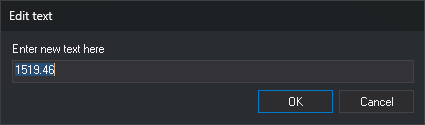

# EDIT\_TEXT
<!-- id: editar-texto -->
<!-- origen: bb45a83afe064af4641091f14282fb2047f90800 -->

Change the content of a text entity in the active drawing file.

## Parameters

This command takes no parameters.

## Notes

The command displays "Select the text to be edited" and asks you to select text with the data or tentative button. Only text entities in the active drawing file can be selected. Other entity types, such as complex entities or dimensions, and deleted text entities are not accepted. If the selected entity is invalid, the error sound plays and the command continues requesting a text entity.

After selection, the **Edit text** dialog displays the current content. The command edits one text entity at a time.

When you accept the dialog:

* If the content has changed, the command replaces the text entity with a copy containing the new content. The copy retains the original code, position, height, rotation, justification, and attributes. It is appended to the drawing file, the original is deleted, and the command completion sound plays. If the original cannot be deleted or the copy cannot be added, the text remains unchanged and the error sound plays.
* If the content has not changed, the text entity remains unchanged.
* If the field is empty, the text entity remains unchanged and the error sound plays. Use a deletion command to delete text.

**Cancel** closes the dialog without changing the text.

[UNDO](/digi3d-ai/referencia/ventana-de-dibujo/ordenes/u/undo.md) undoes the replacement.

If [REPEAT](/digi3d-ai/referencia/ventana-de-dibujo/variables/r/repite.md) is enabled, the command requests another text entity when finished, including after the dialog is canceled.

## Edit text dialog

This dialog requests the new content of the selected text entity.

* **Enter new text here**: text content. Initially contains the current text. This is a single-line field.
* **OK**: replace the text with the field content.
* **Cancel**: close the dialog without changing the text.

## Command characteristics

| Command type | [Interactive command](/digi3d-ai/referencia/ventana-de-dibujo/ordenes-interactivas.md) |
| :--- | :--- |
| Repeats automatically | Yes |
| Menu option | _Edit/Texts/Edit text_ |
| Toolbar | Texts |
| Extension | DigiNG.OrdenesStandard.dll |
| Implementation | Native |
| Related variables | [REPEAT](/digi3d-ai/referencia/ventana-de-dibujo/variables/r/repite.md) — repeat the last command executed |
| Related commands | [CHNG\_TEXT](/digi3d-ai/referencia/ventana-de-dibujo/ordenes/c/camb-texto.md) [DELETE\_TEXT](/digi3d-ai/referencia/ventana-de-dibujo/ordenes/b/borrar-texto.md) [REPLACE\_TEXT](/digi3d-ai/referencia/ventana-de-dibujo/ordenes/r/reemplazar-texto.md) |
| Internal name | {897A5AA9-E36F-4d1c-A943-26C9E489BF5B} |
