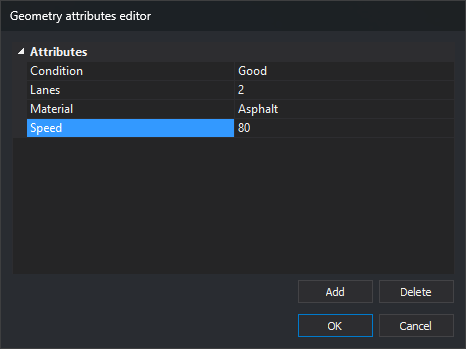
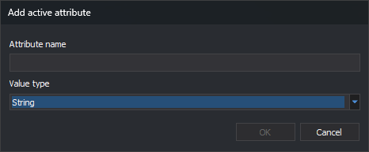

# EDIT\_ATTRIBUTES
<!-- id: editar-atributos -->
<!-- origen: 8adf0ff7471d452d50ac25ecc7f7e658832b9026 -->

Edit the attributes of the selected entity.

## Parameters

This command takes no parameters.

## Notes

The command displays "Select the geometry to edit its attributes", requests an entity from the active drawing file, and opens the **Geometry attributes editor** with its attributes. It edits one entity at a time and does not support multiple selection.

Attributes are name-value pairs stored by the entity itself, as assigned by the [Active attributes](../../../paneles/atributos-activos.md) pane. To edit database attributes linked through entity codes, use [EDIT\_CODES](editar-cod.md).

When you accept the dialog:

* If attributes changed, the command replaces the entity with a copy containing the edited attributes. The copy is appended to the drawing file and the original is deleted. If the copy cannot be added or the original cannot be deleted, the entity remains unchanged and the error sound plays.
* If attributes did not change, the entity remains unchanged.

[UNDO](../u/undo.md) reverses the replacement.

When the dialog closes, Digi3D.AI beeps and the command ends.

## Geometry attributes editor dialog

* **Attributes**: entity attribute list. Each row shows an attribute name and value. Click a value to edit it. Changed values appear in bold.
* **Add**: open **Add active attribute** to add an attribute to the entity.
* **Delete**: remove the selected attribute. With no selection, do nothing.
* **OK**: apply changes to the entity.
* **Cancel**: close without changing the entity.

When entering a value:

* Use a period for decimal numbers (`12.5`), regardless of Windows regional settings. A numeric value containing a comma causes a conversion error.
* Dates follow Windows regional settings.
* If a value cannot be converted to the attribute type, Digi3D.AI displays an error and retains the previous value.
* Clearing a value sets it to NULL. Subsequent input into an attribute without a value is stored as a string.

Attribute names cannot be edited. To rename an attribute, delete it and add another with the new name.

## Add active attribute dialog

**Add** in the attributes editor opens **Add active attribute**. This dialog adds an attribute to the entity, rather than to the active attribute list. Unlike the dialog with the same name in the Active attributes pane, it has no **Automatic value** field.

* **Attribute name**: case-sensitive name. If the entity already has an attribute with that name, the dialog closes without adding it or displaying a warning.
* **Value type**: string, signed or unsigned 8-, 16-, 32-, or 64-bit integer, single- or double-precision floating point, or date. **Cadena de caracteres** is initially selected. The attribute is appended with an empty or zero value, which you then change in the editor.
* **OK**: add the attribute. Disabled while the name is empty.
* **Cancel**: close without adding the attribute.

## Command characteristics

| Command type                                    | [Interactive command](/digi3d-ai/referencia/ordenes/ordenes-interactivas.md) |
| ------------------------------------------------ | ------------------------------------------------------------------------------------ |
| Repeats automatically                           | Yes |
| Menu option           | _Edit/Edit attributes of an entity..._ |
| Toolbar | _This command has no associated toolbar button_ |
| Extension                                        | DigiNG.OrdenesStandard.dll |
| Implementation | Native |
| Related variables                           | [REPEAT](/digi3d-ai/referencia/ventana-de-dibujo/variables/r/repite.md) — repeat the last command executed |
| Related commands                             | [CHNG\_ATTRIBUTES](/digi3d-ai/referencia/ventana-de-dibujo/ordenes/c/camb_atributos.md) [CLONE\_ATTRIBUTES](/digi3d-ai/referencia/ventana-de-dibujo/ordenes/c/clonar_atributos.md) [EDIT\_CODES](/digi3d-ai/referencia/ventana-de-dibujo/ordenes/e/editar-cod.md) [LIST\_ATTRIBUTES](/digi3d-ai/referencia/ventana-de-dibujo/ordenes/l/lista_atributos.md) |
| Internal name                                   | {C3B968CE-2D7C-4D4D-890F-950700FA1EE2} |
