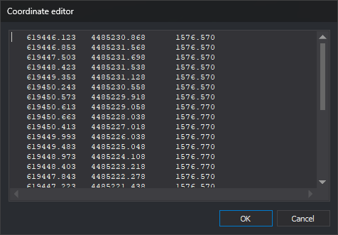

# EDITOR
<!-- id: editor -->
<!-- origen: 9db39ce72aeef67b13d9892749b3effc268d6f1f -->

Edit the vertex coordinates of the selected line in a text box.

## Parameters

This command takes no parameters.

## Notes

When the command starts, the status bar displays "Select a line to edit". Only lines in the current drawing file are accepted. Selecting another geometry type plays the error sound, and the command continues waiting for a selection.

Selecting a line opens the **Coordinate editor** dialog. A monospaced text box contains one line per vertex with its X, Y, and Z coordinates. Each coordinate occupies 13 characters and uses the number of decimal places set by [NDEC](/digi3d-ai/referencia/ventana-de-dibujo/variables/n/ndec.md).

Edit coordinates, add lines to add vertices, and delete lines to remove vertices. Clicking **OK** validates each line:

* Blank lines are ignored.
* Each line must contain three numbers, X Y Z, separated by spaces, tabs, commas, or semicolons, using a period as the decimal separator.
* If a line does not meet these requirements, a message gives its number, the line is selected, and the dialog stays open so you can correct it.
* A line whose numbers match those shown when the dialog opened retains the original full-precision vertex coordinates, even though the displayed values are rounded.

If the coordinates have not changed, the command leaves the line unchanged. Otherwise, it deletes the original line and adds a new line with the same codes and attributes and the vertices from the text box. Deleting every line in the text box deletes the drawing line. [UNDO](/digi3d-ai/referencia/ventana-de-dibujo/ordenes/u/undo.md) reverses the change.

If the original line cannot be deleted (for example, because an extension prevents it), or the new line cannot be added, the drawing file remains unchanged and the error sound plays.

Clicking **Cancel** ends the command without modifying the line.

## Command characteristics

| Command type | [Interactive command](/digi3d-ai/referencia/ordenes/ordenes-interactivas.md) |
| :--- | :--- |
| Repeats automatically | No |
| Menu option | Edit/Edit the coordinates of geometry... |
| Toolbar | _This command has no associated toolbar button_ |
| Extension | DigiNG.OrdenesStandard.dll |
| Implementation | Native |
| Related variables | [NDEC](/digi3d-ai/referencia/ventana-de-dibujo/variables/n/ndec.md) — number of decimal places in coordinates |
| Related commands | [EDIT\_XYZ](/digi3d-ai/referencia/ventana-de-dibujo/ordenes/e/editar-xyz.md) |
| Internal name | {B826AC47-F6A5-4D4B-8FE5-1DCDE8DA0FB1} |
