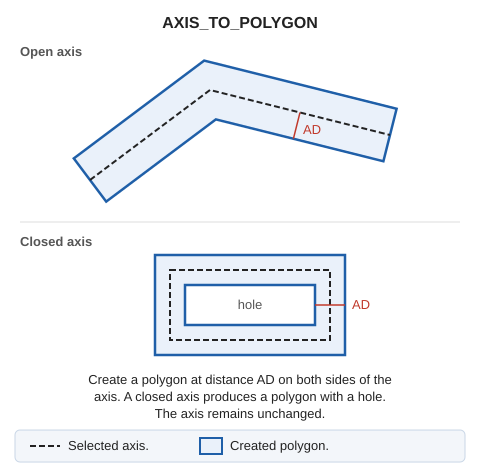

# AXIS\_TO\_POLYGON
<!-- id: eje-a-poligono -->
<!-- origen: a63dd228fe233ab21247dffeb9b226283587d32d -->

Draw a polygon surrounding an existing line.

## Parameters

| Parameter number | Description | Optional |
| :--- | :--- | :--- |
| 1 | Code | Yes |

## Notes

The polygon surrounds the line at equal distances on both sides. A closed line produces a polygon with a hole.

* Without parameters, select the line and enter the distance in the status bar or measure it by digitizing two points. If [REPEAT](/digi3d-ai/referencia/ventana-de-dibujo/variables/r/repite.md) is enabled, request another line.
* With a code, process all visible lines bearing it and end. Use the primary active distance from [AD](/digi3d-ai/referencia/ventana-de-dibujo/variables/d/da.md), and add the secondary active distance to every polygon vertex's Z.

## Command characteristics

| Command type | [Interactive command](/digi3d-ai/referencia/ordenes/ordenes-interactivas.md) |
| :--- | :--- |
| Repeats automatically | No |
| Menu option | Draw/More/Axis to polygon |
| Toolbar | _This command has no associated toolbar button_ |
| Extension | DigiNG.OrdenesStandard.dll |
| Implementation | Native |
| Related variables | [AD](/digi3d-ai/referencia/ventana-de-dibujo/variables/d/da.md) — active distance [REPEAT](/digi3d-ai/referencia/ventana-de-dibujo/variables/r/repite.md) — repeat the last command executed |
| Related commands | No related commands |
| Internal name | {359C0C96-AD11-4819-85E6-60F70DBA6640} |
