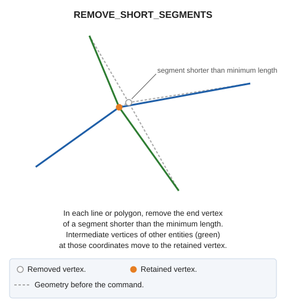
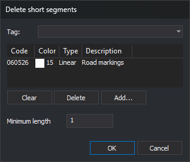

# REMOVE\_SHORT\_SEGMENTS
<!-- id: eliminar-segmentos-cortos -->
<!-- origen: 01e0c3e45fb651ee2f3d11064d1915a13c2ee811 -->

Remove vertices from lines and polygons with the specified codes to eliminate segments shorter than a minimum length. Vertices of other entities coinciding with removed vertices are moved to the retained vertex. To locate short segments without modifying the drawing, use [DETECT\_SHORT\_SEGMENTS](/digi3d-ai/referencia/ventana-de-dibujo/ordenes/d/detectar-segmentos-cortos.md).

## Parameters

| Parameter number | Description | Optional |
| :--- | :--- | :--- |
| 1 | Minimum segment length. Must be a number greater than 0 | Yes |
| 2 onward | Entity codes. Supports wildcards (`*`, `?`) and code table tags with `#` (for example, `#vias_de_comunicacion`) | Yes |

### Examples

`REMOVE_SHORT_SEGMENTS`

Open a dialog to choose codes and minimum length.

`REMOVE_SHORT_SEGMENTS=0.5 060526`

Remove vertices from entities with code `060526` until no segment is shorter than 0.5 units.

## Dialog

Running without parameters, or with only a length, opens [Select codes](/digi3d-ai/referencia/cuadros-de-dialogo/selecciona-codigos.md) titled **Delete short segments**. A length supplied alone is ignored: the dialog uses its saved length.

Below the code list is an additional field:

| Field | Description | Default value |
| :--- | :--- | :--- |
| Minimum length | Minimum horizontal segment length. Must be greater than 0 | Last accepted length; initially 1 |

**OK** is enabled only when the list contains at least one code and minimum length is a number greater than 0. Clicking **OK** saves the length in `LongitudMinima` under registry key `HKEY_CURRENT_USER\Software\Digi21\Digi3D.NET\DigiNG\Extensiones\DigiNG.OrdenesTopologia\DetectarSegmentosCortos`, shared with DETECT\_SHORT\_SEGMENTS. The code list is not saved.

**Cancel** ends without changes.

## Notes

### Entities corrected

The command corrects undeleted, visible lines and polygons in the active drawing file, inside the area of interest, with any specified code. An entity is corrected if a boundary or hole segment is shorter than the minimum length. Length is measured horizontally between consecutive vertices, as in DETECT\_SHORT\_SEGMENTS. A segment equal to the minimum is not short. Lines or holes with fewer than two vertices have no segments and remain unchanged.

For projected \(UTM, Lambert, etc.\) or local drawing window coordinate reference systems, length is in coordinate units. For geographic systems, each boundary and hole is projected into an oblique stereographic projection originating at its first vertex, and length is in meters.

### Vertices removed

The command visits vertices of each line, boundary, and hole from the first:

* Always retain the first vertex.
* Retain each subsequent vertex if its horizontal distance from the last retained vertex is at least the minimum length. Otherwise, remove it.
* Always retain the last vertex. If it is less than the minimum length from the last retained vertex, remove that preceding vertex instead, unless it is the first.

A line therefore always retains at least two vertices, and a short segment may remain between its first and last vertices. A very small polygon, or a triangle with a short side, may end up with fewer than three distinct vertices.

### Vertices of other entities

Each removed vertex is associated with the last retained vertex before it, or with the last entity vertex if its preceding vertex was removed. The command then searches lines and polygons of any code in the active drawing file, including invisible ones, for vertices whose X and Y exactly match a removed vertex. It assigns the retained X and Y, preserves Z, and removes resulting duplicate vertices. If the corrected entity retains that same point elsewhere, vertices of other entities are not moved.

### Result

Each modified entity is replaced by a corrected copy. Entities whose coordinates do not change are not replaced. Progress percentage is displayed, with no summary. [UNDO](/digi3d-ai/referencia/ventana-de-dibujo/ordenes/u/undo.md) reverses the changes.

If the length parameter is not a number greater than 0, "The minimum segment length must be a number greater than 0." appears, the error sound plays, and nothing is modified.

Entities are handled independently: if Digi3D.AI rejects a modified entity, its original is retained and the other entities are still modified.

## Command characteristics

| Command type | [Interactive command](/digi3d-ai/referencia/ordenes/ordenes-interactivas.md) without parameters; immediate command with parameters |
| :--- | :--- |
| Repeats automatically | No |
| Menu option | Geometric analysis/Delete short segments... |
| Toolbar | _This command has no associated toolbar button_ |
| Extension | DigiNG.OrdenesTopologia.dll |
| Implementation | Native |
| Related variables | No related variables |
| Related commands | [DETECT\_SHORT\_SEGMENTS](/digi3d-ai/referencia/ventana-de-dibujo/ordenes/d/detectar-segmentos-cortos.md) [UNDO](/digi3d-ai/referencia/ventana-de-dibujo/ordenes/u/undo.md) |
| Internal name | {C3857680-4931-4331-AB7C-FFD14D3360E3} |
