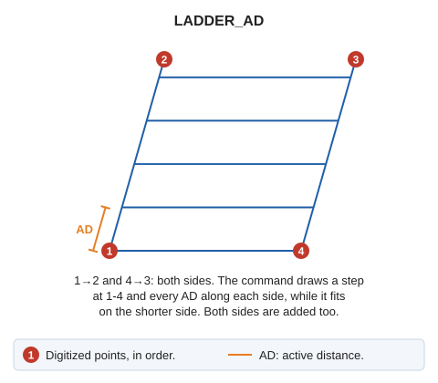

# LADDER\_AD
<!-- id: escalera-da -->
<!-- origen: 250e3fe4d74337b6b80c0e6be975434634d3bf64 -->

Draw stairs in 3D space, specifying the step width.

## Parameters

Does not accept parameters.

## Notes

Before running this command, specify the step width using the [active distance](/digi3d-ai/referencia/ventana-de-dibujo/variables/d/da.md).

Steps are constructed by interpolating between the previously drawn sides.

## Command characteristics

| Command type | [Interactive command](/digi3d-ai/referencia/ordenes/ordenes-interactivas.md) |
| :--- | :--- |
| Repeats automatically | Yes |
| Menu option | Draw/More/Ladder indicating the size of the step |
| Toolbar | Ladders |
| Extension | DigiNG.OrdenesStandard.dll |
| Implementation | Native |
| Related variables | [AD](/digi3d-ai/referencia/ventana-de-dibujo/variables/d/da.md) — active distance [REPEAT](/digi3d-ai/referencia/ventana-de-dibujo/variables/r/repite.md) — repeat the last command executed |
| Related commands | [LADDER](/digi3d-ai/referencia/ventana-de-dibujo/ordenes/e/escalera.md) |
| Internal name | {1C92F11C-0AA2-4455-BAE1-44AB67968372} |
