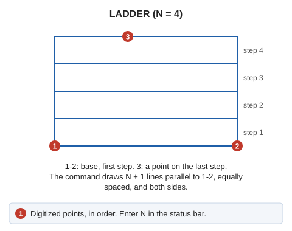

# LADDER
<!-- id: escalera -->
<!-- origen: df61f3e3265347230137bd05cf6d6ddeaa8f8c4a -->

Draw stairs in 3D space.

## Parameters

Does not accept parameters.

## Notes

Enter the number of stair steps. The steps will be parallel to the base.

## Command characteristics

| Command type | [Interactive command](/digi3d-ai/referencia/ordenes/ordenes-interactivas.md) |
| :--- | :--- |
| Repeats automatically | No |
| Menu option | Draw/More/Ladder indicating the number of steps |
| Toolbar | Ladders |
| Extension | DigiNG.OrdenesStandard.dll |
| Implementation | Native |
| Related variables | No related variables |
| Related commands | [SQUARES](/digi3d-ai/referencia/ventana-de-dibujo/ordenes/c/cuadros.md) [LADDER\_AD](/digi3d-ai/referencia/ventana-de-dibujo/ordenes/e/escalera-da.md) |
| Internal name | {9FECD378-BB36-43dc-B635-7D114979A3DC} |
