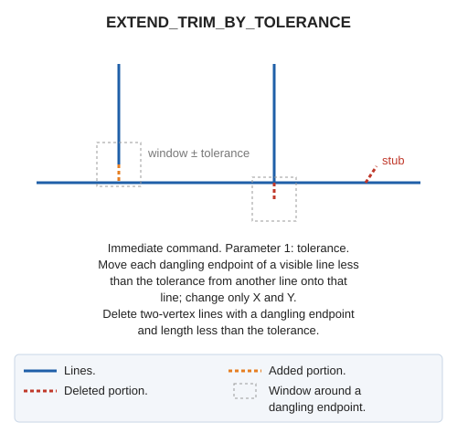

# EXTEND\_TRIM\_BY\_TOLERANCE
<!-- id: estira-recorta-por-tolerancia -->
<!-- origen: 52edfe7e11ce314bf41e5324534d131112282719 -->

Extend or trim endpoints of visible lines to meet other lines.

## Parameters

| Parameter number | Description | Optional |
| :--- | :--- | :--- |
| 1 | Tolerance | No |

## Notes

Work on visible lines in the reference file and their dangling endpoints, which do not touch another line, in two phases:

1. Delete two-vertex lines with a dangling endpoint and plan length less than the tolerance.
2. Adjust each remaining dangling endpoint less than the tolerance from another line. Search a square centered on the endpoint with side twice the tolerance:
   * If a vertex of the other line lies in the square, move the endpoint there.
   * Otherwise, move it to its projection onto the other line.

   Extend lines falling short of the other line; trim those overshooting. Change only endpoint X and Y; retain Z.

If Digi3D.AI rejects any new line, apply no changes and retain all originals.

## Command characteristics

| Command type | [Immediate command](/digi3d-ai/referencia/ordenes/ordenes-no-interactivas.md) |
| :--- | :--- |
| Repeats automatically | No |
| Menu option | _This command has no associated menu option_ |
| Toolbar | _This command has no associated toolbar button_ |
| Extension | DigiNG.OrdenesTopologia.dll |
| Implementation | Native |
| Related variables | No related variables |
| Related commands | [SPR](/digi3d-ai/referencia/ventana-de-dibujo/ordenes/e/ext.md) [TRIM](/digi3d-ai/referencia/ventana-de-dibujo/ordenes/t/trim.md) |
| Internal name | {B247E248-4308-414E-B160-BE4488DB4737} |
