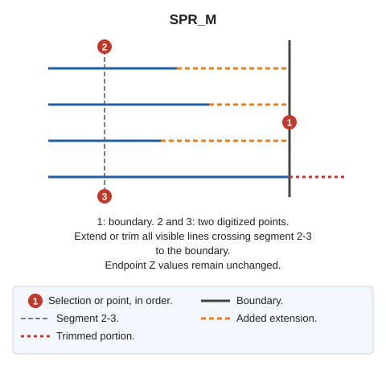

# SPR\_M
<!-- id: ext-m -->
<!-- origen: 363f605d10c823db48e388fcf8b582641f276c34 -->

Extend or trim a group of lines to their intersection with a boundary line.

## Parameters

Does not accept parameters.

## Notes

First select the boundary line, then two points. Adjust all visible lines crossing the segment between those points to the boundary. For each line, test both endpoints and adjust each for which a boundary intersection is found:

* If the line falls short of the boundary, extend it.
* If it overshoots, trim it.

Line endpoints retain their original Z coordinates.

End after processing the two points.

If quality control rejects a modified entity, retain its original unchanged. Handle multiple entities independently: retain the original of each rejected copy and adjust the others.

## Command characteristics

| Command type | [Interactive command](/digi3d-ai/referencia/ordenes/ordenes-interactivas.md) |
| :--- | :--- |
| Repeats automatically | Yes |
| Menu option | Edit/Polylines/Extend multiple lines so that they cross another existing line (2 points) |
| Toolbar | Extend/Cut |
| Extension | DigiNG.OrdenesStandard.dll |
| Implementation | Native |
| Related variables | [REPEAT](/digi3d-ai/referencia/ventana-de-dibujo/variables/r/repite.md) — repeat the last command executed |
| Related commands | [SPR](/digi3d-ai/referencia/ventana-de-dibujo/ordenes/e/ext.md) [SPR\_D](/digi3d-ai/referencia/ventana-de-dibujo/ordenes/e/ext-p.md) [SPR\_PLANE](/digi3d-ai/referencia/ventana-de-dibujo/ordenes/e/ext-plano.md) [SPR\_XYZ](/digi3d-ai/referencia/ventana-de-dibujo/ordenes/e/ext-xyz.md) [SPR2X](/digi3d-ai/referencia/ventana-de-dibujo/ordenes/e/ext2x.md) [EXTEND\_END](/digi3d-ai/referencia/ventana-de-dibujo/ordenes/e/extiende_extremo.md) [TRIM\_M](/digi3d-ai/referencia/ventana-de-dibujo/ordenes/t/trim-m.md) |
| Internal name | {8A015BFD-4882-4f6c-A0BE-5A1A873C2D8D} |
