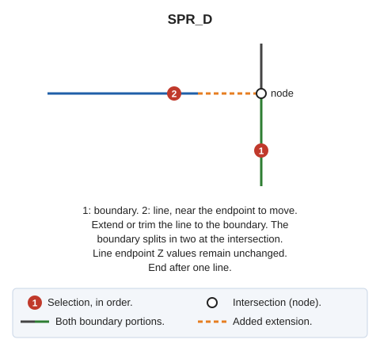

# SPR\_D
<!-- id: ext-p -->
<!-- origen: a8879b3830d8e347b5c3eeda411bae11653a12ad -->

Extend or trim a line to its intersection with a boundary line and split the boundary there to create a node. If the intersection coincides with a boundary line endpoint, do not split it.

## Parameters

Does not accept parameters.

## Notes

First select the boundary line, then the line to adjust. Both must belong to the current model. Use the line selection point to choose the endpoint to adjust, and move it to the boundary intersection:

* If the line falls short of the boundary, extend it.
* If it overshoots, trim it.

Line endpoints retain their original Z coordinates.

Split the boundary into two lines at the intersection. If that point coincides in X and Y with a boundary endpoint, do not split the boundary.

End after adjusting one line.

If quality control rejects any new entity (the extended line or either boundary portion), retain both original entities and add none of the new ones.

## Command characteristics

| Command type | [Interactive command](/digi3d-ai/referencia/ordenes/ordenes-interactivas.md) |
| :--- | :--- |
| Repeats automatically | Yes |
| Menu option | Edit/Polylines/Extend a polyline so that it crosses another existing polyline |
| Toolbar | Extend/Cut |
| Extension | DigiNG.OrdenesStandard.dll |
| Implementation | Native |
| Related variables | [REPEAT](/digi3d-ai/referencia/ventana-de-dibujo/variables/r/repite.md) — repeat the last command executed |
| Related commands | [SPR](/digi3d-ai/referencia/ventana-de-dibujo/ordenes/e/ext.md) [SPR\_M](/digi3d-ai/referencia/ventana-de-dibujo/ordenes/e/ext-m.md) [SPR\_PLANE](/digi3d-ai/referencia/ventana-de-dibujo/ordenes/e/ext-plano.md) [SPR\_XYZ](/digi3d-ai/referencia/ventana-de-dibujo/ordenes/e/ext-xyz.md) [SPR2X](/digi3d-ai/referencia/ventana-de-dibujo/ordenes/e/ext2x.md) [EXTEND\_END](/digi3d-ai/referencia/ventana-de-dibujo/ordenes/e/extiende_extremo.md) |
| Internal name | {F0E5BE92-BAC4-42cb-9ABE-ABBD6C14889C} |
