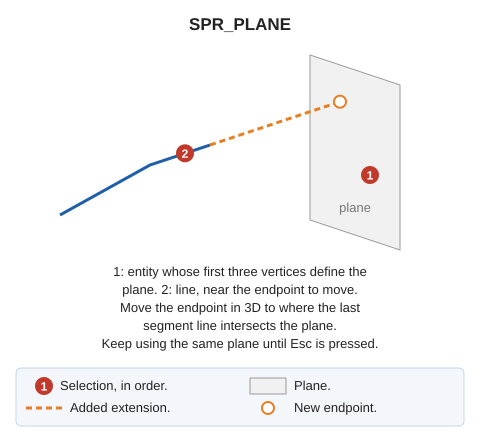

# SPR\_PLANE
<!-- id: ext-plano -->
<!-- origen: 979f143787bb4a904d0a6ef6dcfe3121ae8a099c -->

Select a plane, then a line. Extend the line endpoint nearest the selection point to the plane.

## Parameters

Does not accept parameters.

If quality control rejects the modified entity, the original is retained unchanged.

## Command characteristics

| Command type | [Interactive command](/digi3d-ai/referencia/ordenes/ordenes-interactivas.md) |
| :--- | :--- |
| Repeats automatically | Yes |
| Menu option | _This command has no associated menu option_ |
| Toolbar | _This command has no associated toolbar button_ |
| Extension | DigiNG.OrdenesStandard.dll |
| Implementation | Native |
| Related variables | [REPEAT](/digi3d-ai/referencia/ventana-de-dibujo/variables/r/repite.md) — repeat the last command executed |
| Related commands | [SPR](/digi3d-ai/referencia/ventana-de-dibujo/ordenes/e/ext.md) [SPR\_M](/digi3d-ai/referencia/ventana-de-dibujo/ordenes/e/ext-m.md) [SPR\_D](/digi3d-ai/referencia/ventana-de-dibujo/ordenes/e/ext-p.md) [SPR\_XYZ](/digi3d-ai/referencia/ventana-de-dibujo/ordenes/e/ext-xyz.md) [SPR2X](/digi3d-ai/referencia/ventana-de-dibujo/ordenes/e/ext2x.md) [EXTEND\_END](/digi3d-ai/referencia/ventana-de-dibujo/ordenes/e/extiende_extremo.md) |
| Internal name | {D4C54539-EDFB-4397-983D-EA231076DE1D} |
