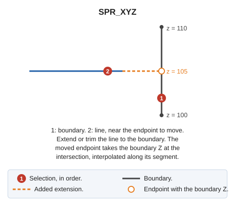

# SPR\_XYZ
<!-- id: ext-xyz -->
<!-- origen: 771f326084c8ab601790f887b61684be23fe31ad -->

Extend or trim an entity to a boundary, setting the adjusted endpoint's Z to the boundary Z.

## Parameters

Does not accept parameters.

## Notes

First select the boundary line, then lines to adjust. Each adjusted line must belong to the current model. Use the line selection point to choose the endpoint to adjust, and move it to the boundary intersection:

* If the line falls short of the boundary, extend it.
* If it overshoots, trim it.

The adjusted endpoint takes the boundary Z, interpolated along the boundary segment containing the intersection.

After adjusting a line, continue requesting lines with the same boundary. Press Esc to discard the boundary and request a new one. Press Esc with no boundary selected to end.

If quality control rejects the modified entity, retain its original unchanged.

## Command characteristics

| Command type | [Interactive command](/digi3d-ai/referencia/ordenes/ordenes-interactivas.md) |
| :--- | :--- |
| Repeats automatically | Yes |
| Menu option | _This command has no associated menu option_ |
| Toolbar | _This command has no associated toolbar button_ |
| Extension | DigiNG.OrdenesStandard.dll |
| Implementation | Native |
| Related variables | [REPEAT](/digi3d-ai/referencia/ventana-de-dibujo/variables/r/repite.md) — repeat the last command executed |
| Related commands | [SPR](/digi3d-ai/referencia/ventana-de-dibujo/ordenes/e/ext.md) [SPR\_M](/digi3d-ai/referencia/ventana-de-dibujo/ordenes/e/ext-m.md) [SPR\_D](/digi3d-ai/referencia/ventana-de-dibujo/ordenes/e/ext-p.md) [SPR\_PLANE](/digi3d-ai/referencia/ventana-de-dibujo/ordenes/e/ext-plano.md) [SPR2X](/digi3d-ai/referencia/ventana-de-dibujo/ordenes/e/ext2x.md) [EXTEND\_END](/digi3d-ai/referencia/ventana-de-dibujo/ordenes/e/extiende_extremo.md) |
| Internal name | {ABE645BA-F678-4D83-A765-C51F852A4354} |
