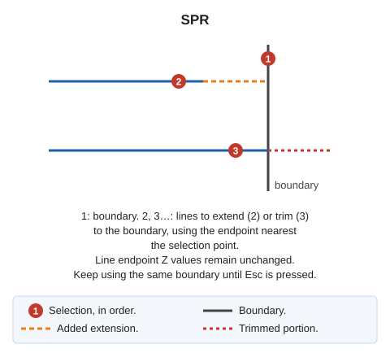

# SPR
<!-- id: ext -->
<!-- origen: a9da1c769838e580d1cfc993a98f28aea883a285 -->

Extend or trim an entity to its intersection with another given entity.

## Parameters

Does not accept parameters.

## Notes

First select the boundary line. The boundary can be a line or polygon; for a polygon, use the exterior boundary or hole containing the selected segment.

Then select lines to adjust to the boundary. Each must belong to the current model. Use the line selection point to choose the endpoint to adjust, and move it to the boundary intersection:

* If the line falls short of the boundary, extend it.
* If it overshoots, trim it.

Line endpoints retain their original Z coordinates.

After adjusting a line, continue requesting lines with the same boundary. Press Esc to discard the boundary and request a new one. Press Esc with no boundary selected to end.

With **EXT can extend out of bounds**, in the **EXT** configuration category, treat the boundary's first and last segments as infinite.

If quality control rejects the modified entity, retain its original unchanged.

## Command characteristics

| Command type | [Interactive command](/digi3d-ai/referencia/ordenes/ordenes-interactivas.md) |
| :--- | :--- |
| Repeats automatically | Yes |
| Menu option | Edit/Polylines/Extend a polyline so that it crosses another |
| Toolbar | Extend/Cut |
| Extension | DigiNG.OrdenesStandard.dll |
| Implementation | Native |
| Related variables | [REPEAT](/digi3d-ai/referencia/ventana-de-dibujo/variables/r/repite.md) — repeat the last command executed |
| Related commands | [EXTEND\_TRIM\_BY\_TOLERANCE](/digi3d-ai/referencia/ventana-de-dibujo/ordenes/e/estira-recorta-por-tolerancia.md) [SPR\_M](/digi3d-ai/referencia/ventana-de-dibujo/ordenes/e/ext-m.md) [SPR\_D](/digi3d-ai/referencia/ventana-de-dibujo/ordenes/e/ext-p.md) [SPR\_PLANE](/digi3d-ai/referencia/ventana-de-dibujo/ordenes/e/ext-plano.md) [SPR\_XYZ](/digi3d-ai/referencia/ventana-de-dibujo/ordenes/e/ext-xyz.md) [SPR2X](/digi3d-ai/referencia/ventana-de-dibujo/ordenes/e/ext2x.md) [EXTEND\_END](/digi3d-ai/referencia/ventana-de-dibujo/ordenes/e/extiende_extremo.md) [TRIM](/digi3d-ai/referencia/ventana-de-dibujo/ordenes/t/trim.md) |
| Internal name | {F67C41E9-7EB7-4574-BB96-D75F6E4BFD2A} |
