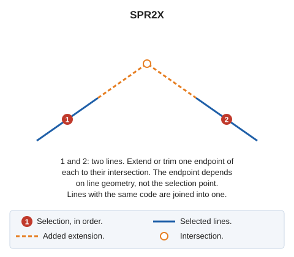

# SPR2X
<!-- id: ext2x -->
<!-- origen: 37bec64b4d0ecee5c8ba1cca602e6768476fd8ca -->

Extend two entities to their intersection.

## Parameters

Does not accept parameters.

## Notes

Select two lines. The second must belong to the current model.

The selection point does not determine which endpoint to extend. For each endpoint of a line, calculate the intersection of its first or last segment's straight line with the other line, accepting it only if it falls on the other line's first or last segment or its extension. If both endpoints yield valid intersections, use the endpoint closest to its intersection. If the first line yields none, try the second.

Move one endpoint of each line to the intersection:

* If the intersection is beyond the endpoint, extend the line.
* If it is on the first or last segment, trim the line.

If no valid intersection exists, sound the error tone and leave both lines unchanged.

If both lines have the same code and database attributes, join them into one with [CONNECT](/digi3d-ai/referencia/ventana-de-dibujo/ordenes/u/unir.md).

If quality control rejects either extended line, retain both original lines and add neither new line.

## Command characteristics

| Command type | [Interactive command](/digi3d-ai/referencia/ordenes/ordenes-interactivas.md) |
| :--- | :--- |
| Repeats automatically | Yes |
| Menu option | Edit/Polylines/Extend two existing lines to their intersection |
| Toolbar | Extend/Cut |
| Extension | DigiNG.OrdenesStandard.dll |
| Implementation | Native |
| Related variables | [REPEAT](/digi3d-ai/referencia/ventana-de-dibujo/variables/r/repite.md) — repeat the last command executed |
| Related commands | [SPR](/digi3d-ai/referencia/ventana-de-dibujo/ordenes/e/ext.md) [SPR\_M](/digi3d-ai/referencia/ventana-de-dibujo/ordenes/e/ext-m.md) [SPR\_D](/digi3d-ai/referencia/ventana-de-dibujo/ordenes/e/ext-p.md) [SPR\_PLANE](/digi3d-ai/referencia/ventana-de-dibujo/ordenes/e/ext-plano.md) [SPR\_XYZ](/digi3d-ai/referencia/ventana-de-dibujo/ordenes/e/ext-xyz.md) [EXTEND\_END](/digi3d-ai/referencia/ventana-de-dibujo/ordenes/e/extiende_extremo.md) [CONNECT](/digi3d-ai/referencia/ventana-de-dibujo/ordenes/u/unir.md) |
| Internal name | {CA81C8F1-AAC5-49fb-9E9D-45F68C7CFC7A} |
