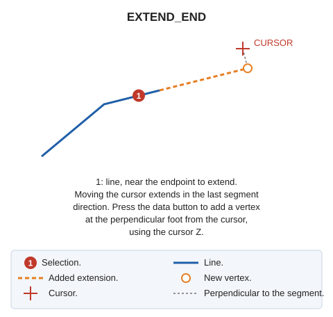

# EXTEND\_END
<!-- id: extiende-extremo -->
<!-- origen: bd92094f73379465a8060b233904d11b429847cd -->

Dynamically extend a polyline endpoint.

## Parameters

Does not accept parameters.

## Notes

Select a polyline. Extend the endpoint nearest the selection point to the perpendicular foot from the cursor onto the last segment's straight line.

If quality control rejects the modified entity, retain its original unchanged.

## Command characteristics

| Command type                                    | [Interactive command](ext.md)                                                                                                                                     |
| ------------------------------------------------ | --------------------------------------------------------------------------------------------------------------------------------------------------------------- |
| Repeats automatically                           | Yes |
| Menu option           | Edit/Polylines/Dynamically extends polyline endpoint                                                                                                   |
| Toolbar | _This command has no associated toolbar button_                                                                                    |
| Extension                                        | DigiNG.OrdenesStandard.dll                                                                                                                                      |
| Implementation | Native |
| Related variables                           | [REPEAT](/digi3d-ai/referencia/ventana-de-dibujo/variables/r/repite.md) — repeat the last command executed |
| Related commands                             | [SPR](/digi3d-ai/referencia/ventana-de-dibujo/ordenes/e/ext.md) [SPR\_M](/digi3d-ai/referencia/ventana-de-dibujo/ordenes/e/ext-m.md) [SPR\_D](/digi3d-ai/referencia/ventana-de-dibujo/ordenes/e/ext-p.md) [SPR\_PLANE](/digi3d-ai/referencia/ventana-de-dibujo/ordenes/e/ext-plano.md) [SPR\_XYZ](/digi3d-ai/referencia/ventana-de-dibujo/ordenes/e/ext-xyz.md) [SPR2X](/digi3d-ai/referencia/ventana-de-dibujo/ordenes/e/ext2x.md) |
| Internal name | {2E2CEEA9-9946-4B2B-87FE-BC1D6175471F} |
