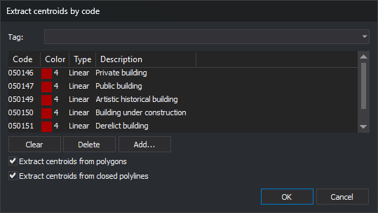

# EXTRACT\_CENTROIDS\_COD
<!-- id: extraer-centroides-cod -->
<!-- origen: 37e613f18fe0e7ec1da284e07094c68c259b36c7 -->

Create a centroid, text at an interior point, in each polygon and closed line in the active drawing file bearing any selected code.

## Parameters

Does not accept parameters.

## Notes

### Dialog box

Running the command displays _Extract centroids by code_:

| Control | Description |
| :--- | :--- |
| Upper drop-down | List code table tags with the `#` prefix. Choosing one fills the code list with codes bearing that tag and clears the drop-down again |
| Code list | Codes of entities in which to create a centroid, with their color, type, and description |
| Clear | Empty the code list |
| Delete | Remove the selected code from the list |
| Add... | Open code selection and add chosen codes to the list |
| Extract centroids from polygons | If selected, create centroids in polygons |
| Extract centroids from closed polylines | If selected, create centroids in closed lines |

Clicking _OK_ with an empty list displays _Error: A code has not been specified for working_ and leaves the dialog box open. If both checkboxes are cleared, display _Select at least one of the two options: polygons or closed polylines._ and leave it open.

The list and checkboxes are not saved: each run starts with an empty list and both checkboxes selected. Only position and size are remembered.

Click _Cancel_ to end without creating anything.

### Entities processed

Traverse entities in the active drawing file and create a centroid in each satisfying all these conditions:

* it is a polygon, if the first checkbox is selected, or a closed line, if the second is selected. A line is closed if its first and last vertices coincide in X and Y, even with different Z values;
* it bears any listed code. One matching code suffices, and matching supports `*` and `?` wildcards;
* it is neither deleted nor hidden, and at least one code is visible in the drawing window;
* it is within the area of interest.

The command does not check whether the entity already has a centroid: running twice creates two centroids in each entity.

### Centroid

Each centroid is text:

* with all the entity's codes;
* whose content is the entity's first code name, which may not be the listed code;
* with angle, height, and justification from AA, TH, and JT;
* with Z coordinate 0, regardless of the entity's Z.

The insertion point is always inside the entity, including concave entities:

* For a polygon, it lies on the horizontal line halfway up its bounding rectangle, inside the exterior boundary and outside holes.
* For a closed line, it is the center of its bounding rectangle if that center is inside the line. Otherwise, it is the midpoint of the longest interior segment of a horizontal line passing through no vertices.

The centroid is not the entity's center of mass.

[UNDO](/digi3d-ai/referencia/ventana-de-dibujo/ordenes/u/undo.md) removes all centroids created by the command in a single operation.

## Command characteristics

| Command type | Immediate command |
| :--- | :--- |
| Repeats automatically | No |
| Menu option | Draw/Centroids/By code... |
| Toolbar | _This command has no associated toolbar button_ |
| Extension | DigiNG.OrdenesTopologia.dll |
| Implementation | Native |
| Related variables | [AA](/digi3d-ai/referencia/ventana-de-dibujo/variables/a/aa.md) — set the active angle [TH](/digi3d-ai/referencia/ventana-de-dibujo/variables/a/at.md) — set the text height [JT](/digi3d-ai/referencia/ventana-de-dibujo/variables/j/jt.md) — change text justification on insertion |
| Related commands | [EXTRACT\_CENTROID](/digi3d-ai/referencia/ventana-de-dibujo/ordenes/e/extraer-centroide.md) [UNDO](/digi3d-ai/referencia/ventana-de-dibujo/ordenes/u/undo.md) |
| Internal name | {356024A0-F29F-44DC-B9F4-82F46594836A} |
