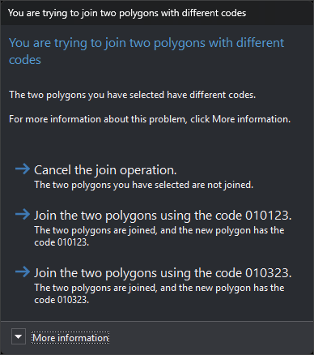

# FORM\_POLYGONS
<!-- id: formar-poligonos -->
<!-- origen: 27f68ee228a6086c731cf1c4c021ad71ce072d16 -->

Create or modify polygons by flooding and remove shared segments.

## Parameters

Does not accept parameters.

## Notes

1. Select the lines and polygons from which to form polygons and press the spacebar. The command splits lines at crossings, discards duplicates, and forms a temporary topology. Each enclosure takes the codes of the smallest selected closed line or polygon containing it.
2. Select two adjacent polygons to locate their shared edges. Moving the mouse over an enclosure highlights it. Press Delete to remove shared edges and join the two polygons, or Esc to deselect them. While shared edges are selected, no further selections are accepted. If the polygons have different codes or attributes, the command asks which to retain or whether to cancel joining. The first join button retains the first selected polygon's code, and the second retains the second polygon's code.

   
3. Press the spacebar to accept. Selected shared edges are deselected without being removed. The command creates a polygon with its holes for each enclosure. If an enclosure has no codes, the command requests a code; canceling skips that enclosure. Entities selected in step 1 are deleted.

If quality control rejects any new polygon, all selected entities are retained and no polygons are added.

The command does not use the loaded topology for flooding: it forms its own temporary topology from entities selected in step 1. Enclosures are highlighted on hover only after the first press of the spacebar.

## Command characteristics

| Command type | [Interactive command](/digi3d-ai/referencia/ordenes/ordenes-interactivas.md) |
| :--- | :--- |
| Repeats automatically | No |
| Menu option | Draw/Polygon using flooding |
| Toolbar | _This command has no associated toolbar button_ |
| Extension | DigiNG.OrdenesTopologia.dll |
| Implementation | Native |
| Related variables | No related variables |
| Related commands | [CREATE\_POLYGON](/digi3d-ai/referencia/ventana-de-dibujo/ordenes/c/crear-poligono.md) [POL](/digi3d-ai/referencia/ventana-de-dibujo/ordenes/p/pol.md) |
| Internal name | {F3F9E21F-BC9A-432E-B9D2-4DCBB070CCE4} |
