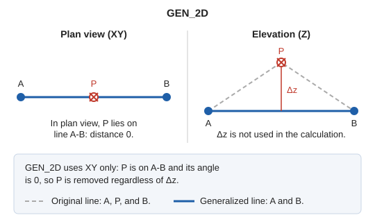

# GEN\_2D
<!-- id: gen-2d -->
<!-- origen: 103b626dd3fea5030c0980645bc435971772b638 -->

Generalize lines and polygons by measuring distances only in the XY plane: vertex Z is not considered. Retain vertices shared with other entities in the drawing file.

## Parameters

| Parameter number | Description | Optional |
| :--- | :--- | :--- |
| 1 | Code. If specified, generalize all entities in the drawing file with that code without prompting for a selection. | Yes |

### Examples

`GEN_2D`

Prompt for the entity to generalize.

`GEN_2D=010123`

Generalize all entities with code `010123`.

## How vertices are removed

Apply the same algorithm as [GEN](/digi3d-ai/referencia/ventana-de-dibujo/ordenes/g/gen.md), using [TOL](/digi3d-ai/referencia/ventana-de-dibujo/variables/t/tol.md) and [TOL\_ANG](/digi3d-ai/referencia/ventana-de-dibujo/variables/t/tol-ang.md), with two differences:

1. **Distances and angles are measured in plan view.** A vertex aligned in plan view with its span's ends is removed even if its Z differs: Z is excluded from the calculation.
2. **Shared vertices are retained.** A vertex whose coordinates appear more than once in the drawing file is retained even if the algorithm would discard it. This keeps entities touching at that vertex connected. Coordinates must match exactly.

The entity's first and last vertices are always retained.

## Notes

- `GEN_2D` does not generalize polygon holes or complex entities. Use [GEN](/digi3d-ai/referencia/ventana-de-dibujo/ordenes/g/gen.md) for them.
- The selected entity must belong to the current model. With a code parameter, entities with that code throughout the drawing file are generalized.

If quality control rejects the modified entity, the original entity is preserved unchanged. With multiple entities, the command handles each independently: the original of each rejected copy is preserved, and the other entities are generalized.

## Command characteristics

| Command type | [Interactive command](/digi3d-ai/referencia/ordenes/ordenes-interactivas.md) |
| :--- | :--- |
| Repeats automatically | Yes |
| Menu option | _This command has no associated menu option_ |
| Toolbar | _This command has no associated toolbar button_ |
| Extension | DigiNG.OrdenesStandard.dll |
| Implementation | Native |
| Related variables | [TOL](/digi3d-ai/referencia/ventana-de-dibujo/variables/t/tol.md) — generalization tolerance factor [TOL\_ANG](/digi3d-ai/referencia/ventana-de-dibujo/variables/t/tol-ang.md) — angular generalization tolerance factor [REPEAT](/digi3d-ai/referencia/ventana-de-dibujo/variables/r/repite.md) — repeat the last command executed |
| Related commands | [DENSIFICA](/digi3d-ai/referencia/ventana-de-dibujo/ordenes/d/densifica.md) [GEN](/digi3d-ai/referencia/ventana-de-dibujo/ordenes/g/gen.md) [TOL](/digi3d-ai/referencia/ventana-de-dibujo/ordenes/t/tol.md) [TOL\_ANG](/digi3d-ai/referencia/ventana-de-dibujo/ordenes/t/tol-ang.md) |
| Internal name | {5F383460-6116-4324-9BA8-38DC97E6E5B1} |
