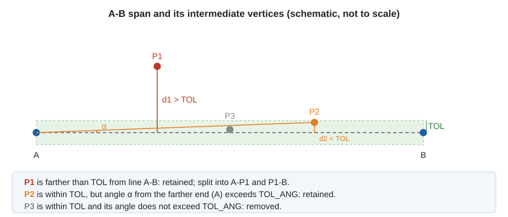
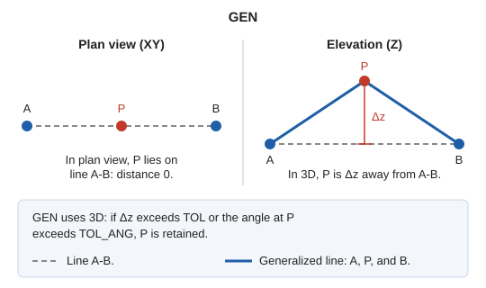

# GEN
<!-- id: gen -->
<!-- origen: 6c121d25818cb9c52d93426681839537f68fe096 -->

Generalize lines, polygons, and complex entities: remove unnecessary vertices by measuring distances in 3D space (X, Y, and Z).

## Parameters

| Parameter number | Description | Optional |
| :--- | :--- | :--- |
| 1 | Code. If specified, generalize all entities in the drawing file with that code without prompting for a selection. | Yes |

### Examples

`GEN`

Prompt for the entity to generalize.

`GEN=010123`

Generalize all entities with code `010123`.

## How vertices are removed

The command applies the Douglas-Peucker algorithm with two tolerances:

- [TOL](/digi3d-ai/referencia/ventana-de-dibujo/variables/t/tol.md): maximum distance, in meters.
- [TOL\_ANG](/digi3d-ai/referencia/ventana-de-dibujo/variables/t/tol-ang.md): maximum angle, in degrees. The initial value when Digi3D.AI starts is 4.58.

The algorithm starts with a single span from the first vertex to the last, then performs the following for each span:

1. Calculate the distance of each intermediate vertex from the straight line through the span's two ends.
2. If any vertex is farther than **TOL**, retain the farthest vertex and repeat the process for the two spans on either side of it.
3. If none exceeds **TOL**, retain the vertex with the greatest angle, viewed from the farther end of the span, provided it exceeds **TOL\_ANG**, and repeat the process on either side.
4. If no vertex exceeds either tolerance, remove all intermediate vertices in the span.

The entity's first and last vertices are always retained. Polygon holes are also generalized, as is each component entity of complex entities.

## GEN or GEN\_2D

`GEN` measures distances in 3D space. A vertex aligned with its neighbors in plan view **is retained** if its Z differs from the straight line by more than **TOL**, or if its angle exceeds **TOL\_ANG**. To ignore Z, use [GEN\_2D](/digi3d-ai/referencia/ventana-de-dibujo/ordenes/g/gen-2d.md), which measures only in the XY plane.

For example, with three vertices aligned in plan view, 5 m apart, and the middle vertex offset in Z:

| Middle vertex Z offset | TOL | TOL\_ANG | GEN | GEN\_2D |
| :--- | :--- | :--- | :--- | :--- |
| 0.5 m | 0.004 | 4.58 | Retained | Removed |
| 0.003 m | 0.004 | 4.58 | Removed | Removed |
| 0.5 m | 1 | 4.58 | Retained (the angle is 5.7°, greater than 4.58°) | Removed |
| 0.5 m | 1 | 6 | Removed | Removed |

## Notes

- With **TOL\_ANG** set to 0, no vertex is removed unless it is exactly aligned with the span's ends: any angle greater than 0 retains it.
- The selected entity must belong to the current model. With a code parameter, entities with that code throughout the drawing file are generalized.

If quality control rejects the modified entity, the original entity is preserved unchanged. With multiple entities, the command handles each independently: the original of each rejected copy is preserved, and the other entities are generalized.

## Command characteristics

| Command type | [Interactive command](/digi3d-ai/referencia/ordenes/ordenes-interactivas.md) |
| :--- | :--- |
| Repeats automatically | Yes |
| Menu option | Edit/Polylines/Generalize |
| Toolbar | Edit polyline |
| Extension | DigiNG.OrdenesStandard.dll |
| Implementation | Native |
| Related variables | [TOL](/digi3d-ai/referencia/ventana-de-dibujo/variables/t/tol.md) — generalization tolerance factor [TOL\_ANG](/digi3d-ai/referencia/ventana-de-dibujo/variables/t/tol-ang.md) — angular generalization tolerance factor [REPEAT](/digi3d-ai/referencia/ventana-de-dibujo/variables/r/repite.md) — repeat the last command executed |
| Related commands | [DENSIFICA](/digi3d-ai/referencia/ventana-de-dibujo/ordenes/d/densifica.md) [GEN\_2D](/digi3d-ai/referencia/ventana-de-dibujo/ordenes/g/gen-2d.md) [TOL](/digi3d-ai/referencia/ventana-de-dibujo/ordenes/t/tol.md) [TOL\_ANG](/digi3d-ai/referencia/ventana-de-dibujo/ordenes/t/tol-ang.md) |
| Internal name | {F8D89367-AF3E-4436-BD02-35C3306D5DE7} |
