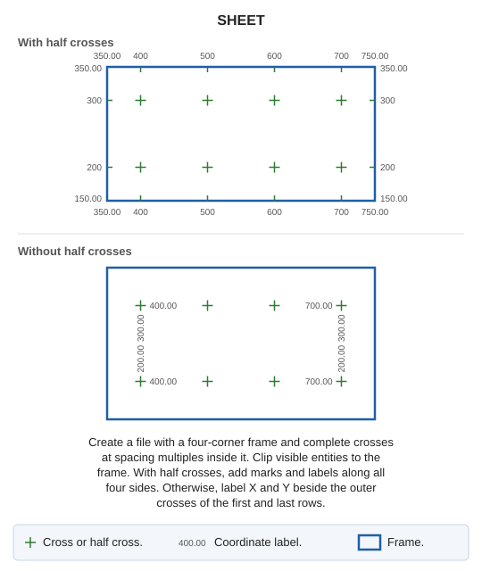
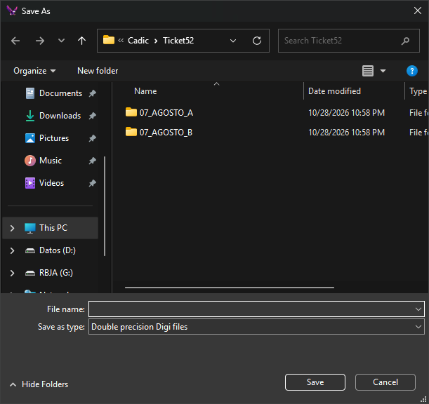

# SHEET
<!-- id: hoja -->
<!-- origen: fda6b420c186b1f75abe1e488a164afea45af097 -->

Create a drawing file with a sheet frame at a specified scale, regularly spaced grid marks, and coordinate labels.

This command takes no parameters.

## Notes

First choose the drawing file to create. Its extension determines the format; format parameters are requested if needed. Existing files require overwrite confirmation. The **Create a sheet** dialog then appears.

Clicking **OK** creates the file with these entities:

* Frame: a closed line joining the four corners, using the frame code.
* A cross formed by horizontal and vertical strokes with the cross code at each point whose X and Y are multiples of ground spacing. A cross is added only if all four endpoints lie inside or on the frame.
* With **Half crosses** enabled:
  * A half cross at each frame edge point whose X (bottom and top) or Y (left and right) is a spacing multiple, excluding corners. Each is half the cross height and points inward.
  * A coordinate label without decimals beside each half cross, outside the frame: below the bottom edge, above the top, left of the left edge, and right of the right edge.
  * X and Y labels at each corner, with the specified decimal places.
* With **Half crosses** disabled, coordinate labels with the specified decimal places beside the leftmost and rightmost crosses in the bottom and top cross rows: X lies beside the cross toward the interior; Y is rotated 90°, above bottom-row crosses and below top-row crosses.
* Visible entities within the area of interest from all loaded drawing files, current and reference, excluding disabled codes:
  * Lines clipped to the frame, copying their interior portions.
  * Points and text whose insertion points are inside the frame.
  * Polygons, complex entities, multipoints, and images entirely inside the frame. Those crossing it are not copied.

Property measurements are in paper millimeters. Ground values equal value × scale ÷ 1000: at scale 1000 with spacing 100, crosses are 100 m apart.

Crosses, half crosses, and labels always follow the X and Y axes. Entering four corners for a rotated sheet rotates the frame, but the marks are not rotated.

A `.utm` file is created beside the new drawing file, containing corner coordinates one per line in this order: bottom-left, bottom-right, top-right, top-left. If it cannot be created, the Tasks pane shows the error and the sheet is created anyway.

The open drawing file is unchanged, so there is nothing to undo. The new file is not opened.

Canceling file selection plays the error sound and ends the command. If the file cannot be created, an error message appears.

## Create a sheet dialog

* **Corners**: each has X and Y fields at its corresponding dialog position.
  * Enter bottom-left and top-right corners. Both start at `0.0`.
  * Top-left and bottom-right corners start empty with gray previews. On **OK**, empty fields are completed from the other two corners, producing an axis-aligned rectangle: top-left uses bottom-left X and top-right Y; bottom-right uses top-right X and bottom-left Y.
  * For a rotated sheet, enter all four corners.
* **General properties**
  * **Scale**: enter or select sheet scale. Must be greater than 0.
  * **Mark code**: frame line code.
* **Cross properties**
  * **Cross code**: code for crosses and half crosses.
  * **Cross height**: length of each cross stroke in paper mm.
  * **Separation crosses**: spacing in paper mm. Must be greater than 0.
  * **Half crosses**: add half crosses and labels at the frame edge.
* **Coordinate properties**
  * **Coordinate code**: coordinate label code.
  * **Coordinate height**: label height in paper mm.
  * **No. of decimals**: decimal places for corner labels and, without half crosses, all labels.

If scale or spacing is not greater than 0, a message appears and the dialog stays open.

Digi3D.AI remembers properties between runs, but not corner coordinates. Initially, scale is the configured Digi3D.AI scale or 1000 if none is configured; cross height is 10 paper mm, spacing is 100 paper mm, coordinate label height is 2 paper mm, codes are `HOJAS`, half crosses are enabled, and decimal places are 2.

## Command characteristics

| Command type | [Interactive command](/digi3d-ai/referencia/ventana-de-dibujo/ordenes-interactivas.md) |
| :--- | :--- |
| Repeats automatically | No |
| Menu option | Draw/Sheet index/Create a sheet from known coordinates |
| Toolbar | _This command has no associated toolbar button_ |
| Extension | DigiNG.OrdenesStandard.dll |
| Implementation | Native |
| Related variables | No related variables |
| Related commands | [TRIM\_TRACE](/digi3d-ai/referencia/ventana-de-dibujo/ordenes/r/recorta-traza.md) [TRACE](/digi3d-ai/referencia/ventana-de-dibujo/ordenes/t/traza.md) |
| Internal name | {CF3F30DF-C61A-4424-AF32-AE28716A0EEC} |
