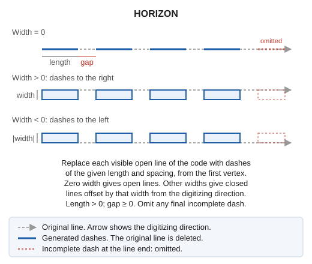
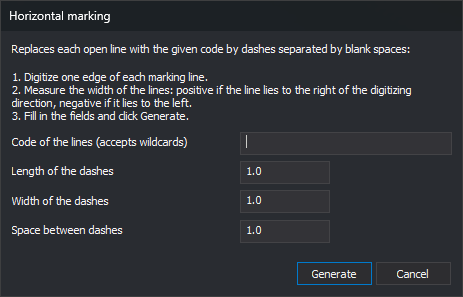

# HORIZON
<!-- id: horizon -->
<!-- origen: 87b06c6ee12fdaa05d77693016cef2f0e360972e -->

Replace each open line with a specified code by fixed-length dashes separated by gaps, to draw dashed road markings. Each dash can be an open line or a closed polygon with a width.

## Parameters

This command takes no parameters.

## Notes

### Dialog

The command opens **Horizontal marking**. Follow these steps:

1. Digitize one edge of each marking line as an open line, using the same code.
2. Measure the marking width.
3. Run HORIZON, fill in the fields, and click **Generate**.

| Field | Description | Default value |
| :--- | :--- | :--- |
| Code of the lines (accepts wildcards) | Code of lines to replace. Supports case-sensitive `*` (any sequence of characters to the end of the code) and `?` (any single character) | Empty |
| Length of the dashes | Horizontal length of each dash along the line. Must be greater than 0 | 1.0 |
| Width of the dashes | Zero creates an open line. A positive value creates a closed polygon extending that width to the right of the digitizing direction; a negative value extends to the left | 1.0 |
| Space between dashes | Horizontal gap length along the line. Must be zero or greater | 1.0 |

All three measurements use drawing file coordinate units.

**Generate** validates the three numeric values. If any is not a number or fails its condition, a message appears, focus moves to that field, and the dialog stays open without saving anything. Valid values are saved as `Codigo`, `Largo`, `Ancho`, and `Espacio` under registry key `HKEY_CURRENT_USER\Software\Digi21\Digi3D.NET\DigiNG\Extensiones\DigiNG.OrdenesStandard\Horizon`. They appear the next time the command runs.

**Cancel** ends without saving values or modifying the file.

### Lines processed

The command processes active drawing file lines meeting all these conditions:

* They have the specified code as a primary or secondary code.
* They are open.
* They are visible and inside the area of interest.

Closed lines, reference file lines, and other entities remain unchanged. An empty code field processes no lines.

### Dashes

For each line, the command starts at the first vertex and follows the digitizing direction: a dash of the specified length, a gap of the specified spacing, then another dash, continuing to the last vertex. A dash crossing a line vertex includes that vertex. Dash endpoint Z is interpolated between the two vertices of the containing segment.

* With zero width, each dash is an open line along the original line.
* With nonzero width, each dash is a closed line following the original section and returning along a parallel offset by the specified width. A straight dash produces a rectangle.

If a line ends partway through a dash, the final dash is omitted. A line shorter than the dash length disappears without leaving any dash.

The command deletes each original line and adds its dashes to the active drawing file. Dashes **do not** retain the original line code: they use the active code and active attributes.

During generation, vertices are not inserted at intersections even when automatic insertion is enabled. Its previous setting is restored afterward.

Before modifying the file, the command estimates the dash count. More than 1,000,000 dashes causes a message and ends without changes. Increase dash length or spacing.

If an extension or file format prevents a line from being deleted, it remains without dashes and the error sound plays.

[UNDO](/digi3d-ai/referencia/ventana-de-dibujo/ordenes/u/undo.md) restores all original lines and removes all dashes in one operation.

## Command characteristics

| Command type | [Interactive command](/digi3d-ai/referencia/ordenes/ordenes-interactivas.md) |
| :--- | :--- |
| Repeats automatically | No |
| Menu option | Draw/More/Horizontal marking lines |
| Toolbar | Horizontal marking |
| Extension | DigiNG.OrdenesStandard.dll |
| Implementation | Native |
| Related variables | No related variables |
| Related commands | [ZEBRA](/digi3d-ai/referencia/ventana-de-dibujo/ordenes/c/cebra.md) [ZEBRA\_4P](/digi3d-ai/referencia/ventana-de-dibujo/ordenes/c/cebra-4p.md) [UNDO](/digi3d-ai/referencia/ventana-de-dibujo/ordenes/u/undo.md) |
| Internal name | {340C33D2-7D89-4772-AFF1-D274F8735395} |
