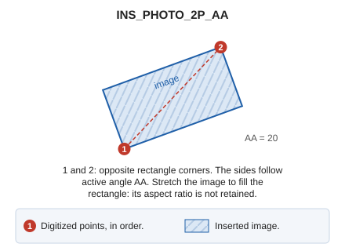

# INS\_PHOTO\_2P\_AA
<!-- id: ins-foto-2p-aa -->
<!-- origen: 412668aee2449d19ccc4d1ea9bbc289386629620 -->

Insert an image into the drawing file using two points and the active angle.

## Parameters

Does not accept parameters.

## Notes

First set the active angle ([AA](/digi3d-ai/referencia/ventana-de-dibujo/variables/a/aa.md)). Image sides follow that angle.

Choose the image file, then specify opposite corners of its rectangle. Stretch the image to fill the rectangle even if its aspect ratio changes. Enter points in these ways:

* Graphically, with the cursor/mouse.
* Enter coordinates using the keyboard \([XY](/digi3d-ai/referencia/ventana-de-dibujo/ordenes/x/xy.md)\).
* Read points from a file \([N](/digi3d-ai/referencia/ventana-de-dibujo/ordenes/n/n.md)\).

## Command characteristics

| Command type | [Interactive command](/digi3d-ai/referencia/ordenes/ordenes-interactivas.md) |
| :--- | :--- |
| Repeats automatically | No |
| Menu option | Draw/Image/By two points and active angle... |
| Toolbar | _This command has no associated toolbar button_ |
| Extension | DigiNG.OrdenesRaster.dll |
| Implementation | Native |
| Related variables | [AA](/digi3d-ai/referencia/ventana-de-dibujo/variables/a/aa.md) — active angle |
| Related commands | [INS\_PHOTO](/digi3d-ai/referencia/ventana-de-dibujo/ordenes/i/ins-foto.md) [INS\_PHOTO\_3P](/digi3d-ai/referencia/ventana-de-dibujo/ordenes/i/ins-foto-3p.md) |
| Internal name | {3402C7CF-6346-4C66-A043-EE0869AF6F4C} |
