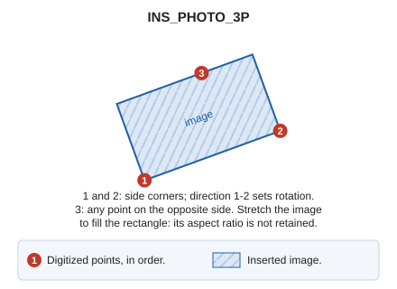

# INS\_PHOTO\_3P
<!-- id: ins-foto-3p -->
<!-- origen: 2e739e71d5141bda21f50822f347cb916f365dd8 -->

Insert an image into the drawing file using three points.

## Parameters

Does not accept parameters.

## Notes

First choose the image file. Then enter 3 points: the first two are corners of one side, and the third is any point on the opposite side \(it need not be a corner\).

Define points graphically or with [XY](/digi3d-ai/referencia/ventana-de-dibujo/ordenes/x/xy.md).

The image occupies the rectangle defined by the three digitized points. The first-to-second point direction determines its rotation. Stretch the image to fill the rectangle, even if this changes its aspect ratio.

## Command characteristics

| Command type | [Interactive command](/digi3d-ai/referencia/ordenes/ordenes-interactivas.md) |
| :--- | :--- |
| Repeats automatically | No |
| Menu option | Draw/Image/By three points... |
| Toolbar | _This command has no associated toolbar button_ |
| Extension | DigiNG.OrdenesRaster.dll |
| Implementation | Native |
| Related variables | No related variables |
| Related commands | [INS\_PHOTO](/digi3d-ai/referencia/ventana-de-dibujo/ordenes/i/ins-foto.md) [INS\_PHOTO\_2P\_AA](/digi3d-ai/referencia/ventana-de-dibujo/ordenes/i/ins-foto-2p-aa.md) |
| Internal name | {0339F78C-FCBF-46E3-8FCA-7F0B19B4D956} |
