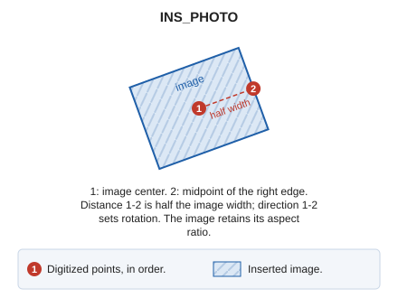

# INS\_PHOTO
<!-- id: ins-foto -->
<!-- origen: bbbe923be859525537ca53daf03094bedf249d7d -->

Insert an image into the drawing file using two points: the first specifies its center, and the second determines rotation and scale.

## Parameters

Does not accept parameters.

## Notes

First choose the image file. Then:

1. Digitize the image center.
2. Digitize the midpoint of its right edge. The distance between these points is half the image width, and the direction from the first point to the second determines rotation.

The image's aspect ratio is preserved.

## Command characteristics

| Command type | [Interactive command](/digi3d-ai/referencia/ordenes/ordenes-interactivas.md) |
| :--- | :--- |
| Repeats automatically | No |
| Menu option | Draw/Image/By two points: Center and Radius... |
| Toolbar | _This command has no associated toolbar button_ |
| Extension | DigiNG.OrdenesRaster.dll |
| Implementation | Native |
| Related variables | No related variables |
| Related commands | [INS\_PHOTO\_2P\_AA](/digi3d-ai/referencia/ventana-de-dibujo/ordenes/i/ins-foto-2p-aa.md) [INS\_PHOTO\_3P](/digi3d-ai/referencia/ventana-de-dibujo/ordenes/i/ins-foto-3p.md) |
| Internal name | {F0CE7FBF-190A-4007-BBD6-6737934D86CE} |
