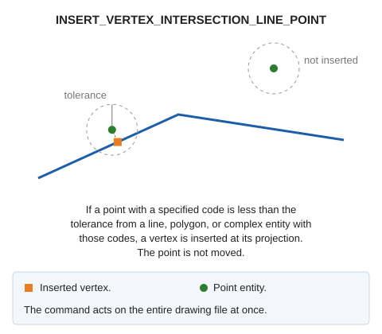

# INSERT\_VERTEX\_INTERSECTION\_LINE\_POINT
<!-- id: insertar-vertice-interseccion-linea-punto -->
<!-- origen: c845be13a6b66b3e14d8c7c399f28b380a33e257 -->

Insert a vertex at intersections of lines with points.

## Parameters

| Parameter number | Description | Optional |
| :--- | :--- | :--- |
| 1 | Tolerance | No |
| 2 | One or more codes | Yes |

Each entity is handled independently: if Digi3D.AI rejects a modified line, that line's original version is preserved, and the other lines are modified.

## Command characteristics

| Command type | [Immediate command](/digi3d-ai/referencia/ordenes/ordenes-no-interactivas.md) |
| :--- | :--- |
| Repeats automatically | No |
| Menu option | _This command has no associated menu option_ |
| Toolbar | _This command has no associated toolbar button_ |
| Extension | DigiNG.OrdenesTopologia.dll |
| Implementation | Native |
| Related variables | No related variables |
| Related commands | [INSERT\_VERTEX\_LINES\_INTERSECCION](/digi3d-ai/referencia/ventana-de-dibujo/ordenes/i/insertar-vertice-interseccion-lineas.md) [INSERT\_VERTEX\_INTERSECTION\_VISIBLE\_LINES](/digi3d-ai/referencia/ventana-de-dibujo/ordenes/i/insertar-vertice-interseccion-lineas-visibles.md) |
| Internal name | {068C793B-D70E-4CAB-8B26-DE4CA9252403} |
