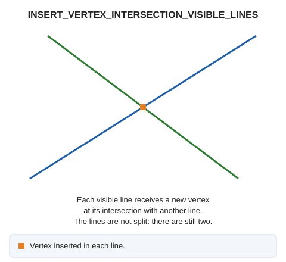

# INSERT\_VERTEX\_INTERSECTION\_VISIBLE\_LINES
<!-- id: insertar-vertice-interseccion-lineas-visibles -->
<!-- origen: 97247e964992b6f7c033eb1f6d46784d57669c40 -->

Insert a vertex at intersections of lines visible in the orthogonal view.

## Parameters

Does not accept parameters.

If Digi3D.AI rejects any new line, the command does not apply the change, and all original lines are preserved.

## Command characteristics

| Command type | [Immediate command](/digi3d-ai/referencia/ordenes/ordenes-no-interactivas.md) |
| :--- | :--- |
| Repeats automatically | No |
| Menu option | Geometric analysis/Insert a vertex at the point where two lines cross/Visible lines |
| Toolbar | _This command has no associated toolbar button_ |
| Extension | DigiNG.OrdenesTopologia.dll |
| Implementation | Native |
| Related variables | No related variables |
| Related commands | [INSERT\_VERTEX\_INTERSECTION\_LINE\_POINT](/digi3d-ai/referencia/ventana-de-dibujo/ordenes/i/insertar-vertice-interseccion-linea-punto.md) [INSERT\_VERTEX\_LINES\_INTERSECCION](/digi3d-ai/referencia/ventana-de-dibujo/ordenes/i/insertar-vertice-interseccion-lineas.md) [SPLIT\_VISIBLES\_LINES](/digi3d-ai/referencia/ventana-de-dibujo/ordenes/p/partir-lineas-visibles.md) |
| Internal name | {9E65A1B2-F4B9-447B-AC7E-D37FF62B4304} |
