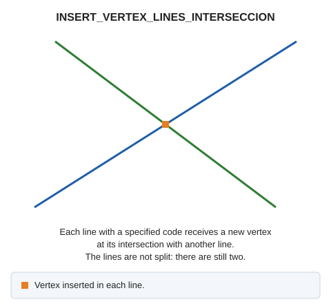

# INSERT\_VERTEX\_LINES\_INTERSECCION
<!-- id: insertar-vertice-interseccion-lineas -->
<!-- origen: f9e8534787bb1475b8bd2316893d136dd670b714 -->

Insert a vertex at intersections of lines with the codes supplied as parameters.

## Parameters

| Parameter number | Description | Optional |
| :--- | :--- | :--- |
| 1 | One or more codes, separated by spaces | Yes |

If Digi3D.AI rejects any new line, the command does not apply the change, and all original lines are preserved.

## Command characteristics

| Command type | [Immediate command](/digi3d-ai/referencia/ordenes/ordenes-no-interactivas.md) |
| :--- | :--- |
| Repeats automatically | No |
| Menu option | _This command has no associated menu option_ |
| Toolbar | _This command has no associated toolbar button_ |
| Extension | DigiNG.OrdenesTopologia.dll |
| Implementation | Native |
| Related variables | No related variables |
| Related commands | [INSERT\_VERTEX\_INTERSECTION\_LINE\_POINT](/digi3d-ai/referencia/ventana-de-dibujo/ordenes/i/insertar-vertice-interseccion-linea-punto.md) [INSERT\_VERTEX\_INTERSECTION\_VISIBLE\_LINES](/digi3d-ai/referencia/ventana-de-dibujo/ordenes/i/insertar-vertice-interseccion-lineas-visibles.md) [SPIT\_LINES](/digi3d-ai/referencia/ventana-de-dibujo/ordenes/p/partir-lineas.md) |
| Internal name | {59BA7DE5-4A58-45FB-9B17-41D40612F28C} |
