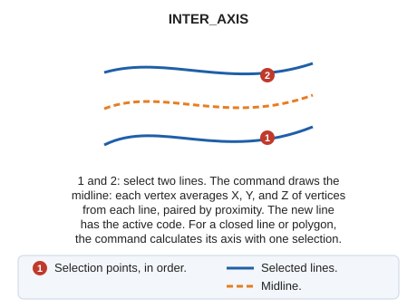

# INTER\_AXIS
<!-- id: inter-eje -->
<!-- origen: 25033efbab6077e1573a383fd4403acd65bc6660 -->

Interpolate an entity between two entities you select.

## Parameters

Does not accept parameters.

## Notes

Interpolation uses \(X Y Z\) coordinates. The new entity is recorded with the code active when the command is run.

If the first selected entity is a polygon or a line closed in plan view, the command does not request a second line: it calculates the entity's axis with a single selection. To do this, it triangulates the boundary and joins the midpoints of the triangles' interior edges. For a polygon, the command uses only the exterior boundary.

The command rejects zigzag lines: lines with a vertex whose previous and next vertices coincide. For such a line, it sounds an error tone and displays "The selected line has a ZigZag".

## Command characteristics

| Command type | [Interactive command](/digi3d-ai/referencia/ordenes/ordenes-interactivas.md) |
| :--- | :--- |
| Repeats automatically | No |
| Menu option | Draw/Interpolate axis of two existing lines |
| Toolbar | Interpolation |
| Extension | DigiNG.OrdenesStandard.dll |
| Implementation | Native |
| Related variables | No related variables |
| Related commands | [INTER](/digi3d-ai/referencia/ventana-de-dibujo/ordenes/i/inter.md) |
| Internal name | {4B787BBC-9658-4f8c-B83E-C83D3005FC91} |
