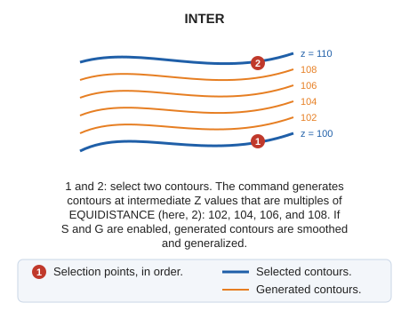

# INTER
<!-- id: inter -->
<!-- origen: 6354116c04e408692bb93826e7a07810767ea208 -->

Interpolate contours.

## Parameters

Does not accept parameters.

## Command characteristics

| Command type | [Interactive command](/digi3d-ai/referencia/ordenes/ordenes-interactivas.md) |
| :--- | :--- |
| Repeats automatically | Yes |
| Menu option | Draw/Interpolate curves between two existing lines |
| Toolbar | Interpolation |
| Extension | DigiNG.OrdenesStandard.dll |
| Implementation | Native |
| Related variables | [EQUIDISTANCE](/digi3d-ai/referencia/ventana-de-dibujo/variables/e/equidistancia.md) — contour interval [G](/digi3d-ai/referencia/ventana-de-dibujo/variables/g/g.md) — enable or disable generalization [INC](/digi3d-ai/referencia/ventana-de-dibujo/variables/i/inc.md) — active recording increment [S](/digi3d-ai/referencia/ventana-de-dibujo/variables/s/s.md) — automatically smooth the line when it is finished [TOL](/digi3d-ai/referencia/ventana-de-dibujo/variables/t/tol.md) — generalization tolerance factor [TOL\_ANG](/digi3d-ai/referencia/ventana-de-dibujo/variables/t/tol-ang.md) — angular generalization tolerance factor [REPEAT](/digi3d-ai/referencia/ventana-de-dibujo/variables/r/repite.md) — repeat the last command executed |
| Related commands | [INTER\_AXIS](/digi3d-ai/referencia/ventana-de-dibujo/ordenes/i/inter-eje.md) [INTERPOLATE\_COD](/digi3d-ai/referencia/ventana-de-dibujo/ordenes/i/interpolar-cod.md) |
| Internal name | {E9F6E1A7-6F37-4f99-98F1-5141B6EE85C4} |
