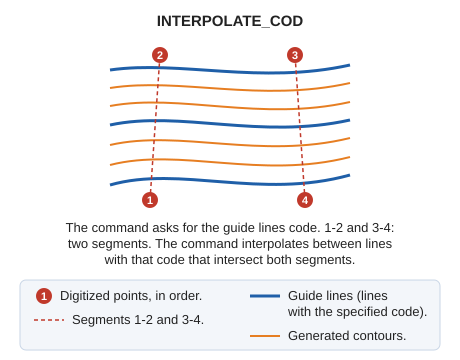

# INTERPOLATE\_COD
<!-- id: interpolar-cod -->
<!-- origen: fc9169bb3d5c0b6a16d2da05b6d243c429585394 -->

Interpolate contours using four points, with entities of a specified code as guide lines.

## Parameters

Does not accept parameters.

## Command characteristics

| Command type | [Interactive command](/digi3d-ai/referencia/ordenes/ordenes-interactivas.md) |
| :--- | :--- |
| Repeats automatically | No |
| Menu option | Draw/Interpolate curves with 4 points... |
| Toolbar | Interpolation |
| Extension | DigiNG.OrdenesStandard.dll |
| Implementation | Native |
| Related variables | No related variables |
| Related commands | [INTER](/digi3d-ai/referencia/ventana-de-dibujo/ordenes/i/inter.md) |
| Internal name | {949F298F-5D9A-4762-88C8-B8514EEFA9AE} |
