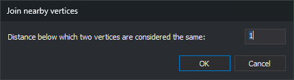
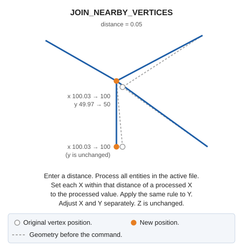

# JOIN\_NEARBY\_VERTICES
<!-- id: juntar-vertices-cercanos -->
<!-- origen: a81910d53bc021a1417f0d655b4c05f83de49dba -->

Equalize vertex X coordinates and vertex Y coordinates in the active drawing file when they differ by no more than the specified distance.

## Parameters

This command takes no parameters.

## Notes

### Dialog

The **Join nearby vertices** dialog requests the distance:

| Field | Description | Default value |
| :--- | :--- | :--- |
| Distance below which two vertices are considered the same: | Maximum difference, in drawing file units, between two X coordinates or two Y coordinates for them to take the same value | 1 |

The dialog always starts with 1: the command does not save the distance between runs. If the text is not a number, a warning appears and the dialog stays open. Clicking **Cancel** ends the command without making changes.

### How coordinates are joined

The command visits entities in the active drawing file in file order, skipping deleted entities. For each entity, it processes:

* Its vertices (the insertion point for a point or text entity; the insertion point for a complex entity).
* Hole vertices, if it is a polygon.
* Vertices of the entities forming a complex entity. Holes of polygons inside a complex entity and entities inside a nested complex entity are not processed.

X and Y coordinates are handled separately. Each X is compared with previously processed X values: if one differs by no more than the specified distance, that value is assigned to X. Otherwise, X is retained and added to the processed X values. The same applies to Y. Consequently:

* Distant vertices whose X values differ by no more than the distance receive the same X even if their Y values differ greatly.
* The retained value belongs to the vertex processed earlier, so the result depends on entity order in the file.

Z does not change. A negative distance leaves all coordinates unchanged.

### Result

The command replaces each entity with a corrected copy if any X or Y coordinate changed. Other entities remain untouched. If no entities change, the active drawing file is not modified. No completion message appears.

## Command characteristics

| Command type | Immediate command |
| :--- | :--- |
| Repeats automatically | No |
| Menu option | Geometric analysis/Join nearby vertices... |
| Toolbar | _This command has no associated toolbar button_ |
| Extension | DigiNG.OrdenesTopologia.dll |
| Implementation | Native |
| Related variables | No related variables |
| Related commands | [JOIN](/digi3d-ai/referencia/ventana-de-dibujo/ordenes/j/juntar.md) |
| Internal name | {8312B2CC-7C50-456A-81A0-36737CE1B41C} |
