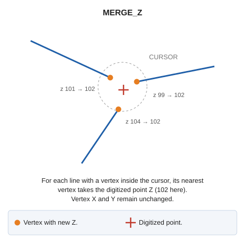

# MERGE\_Z
<!-- id: juntar-z -->
<!-- origen: f675ed11593410609bd32a66639385f204fc082b -->

Assign a digitized point's Z to the nearest vertex of each nearby line.

## Parameters

| Parameter number | Description | Values | Optional |
| :--- | :--- | :--- | :--- |
| 1 | Cursor size in pixels | Integer | Yes |

Without a parameter, use the drawing window's cursor size.

## Notes

After digitizing a point, find visible lines with a vertex inside the cursor size. Change only the nearest vertex of each line to take the digitized point's Z. Other vertices are unchanged. Do not modify X or Y.

End after processing one point.

If quality control rejects a modified entity, retain its original unchanged. Handle multiple entities independently: retain each rejected original and modify the others.

## Command characteristics

| Command type | [Interactive command](/digi3d-ai/referencia/ordenes/ordenes-interactivas.md) |
| :--- | :--- |
| Repeats automatically | Yes |
| Menu option | _This command has no associated menu option_ |
| Toolbar | _This command has no associated toolbar button_ |
| Extension | DigiNG.OrdenesStandard.dll |
| Implementation | Native |
| Related variables | [REPEAT](/digi3d-ai/referencia/ventana-de-dibujo/variables/r/repite.md) — repeat the last command executed |
| Related commands | [JOIN](/digi3d-ai/referencia/ventana-de-dibujo/ordenes/j/juntar.md) |
| Internal name | {A8120372-9CF4-4ff9-A6DE-035E717C746A} |
