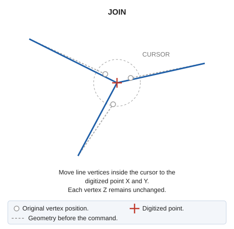

# JOIN
<!-- id: juntar -->
<!-- origen: 9db9eb7c27ce2d6d813757c7b6bd6c82f21a35ff -->

Move all points inside the cursor to the digitized point. Change only vertex X and Y coordinates; Z remains unchanged.

## Parameters

| Parameter number | Description | Values | Optional |
| :--- | :--- | :--- | :--- |
| 1 | Cursor size in pixels | Integer | Yes |

Without a parameter, use the drawing window's cursor size.

If quality control rejects a modified entity, retain its original unchanged. Handle multiple entities independently: retain the original of each rejected entity and modify the others.

## Command characteristics

| Command type | [Interactive command](/digi3d-ai/referencia/ordenes/ordenes-interactivas.md) |
| :--- | :--- |
| Repeats automatically | Yes |
| Menu option | _This command has no associated menu option_ |
| Toolbar | _This command has no associated toolbar button_ |
| Extension | DigiNG.OrdenesStandard.dll |
| Implementation | Native |
| Related variables | [REPEAT](/digi3d-ai/referencia/ventana-de-dibujo/variables/r/repite.md) — repeat the last command executed |
| Related commands | [JOIN\_NEARBY\_VERTICES](/digi3d-ai/referencia/ventana-de-dibujo/ordenes/j/juntar-vertices-cercanos.md) [MERGE\_Z](/digi3d-ai/referencia/ventana-de-dibujo/ordenes/j/juntar-z.md) |
| Internal name | {7B3A0FBA-E03F-4c93-909C-6183536653FB} |
