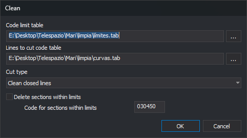

# CLEAN
<!-- id: limpia -->
<!-- origen: aa16d6e5819be6bd2025620965dcb2c5acca0c8d -->

Split lines crossing boundaries formed by text, lines, or polygons, and delete or recode portions inside those boundaries.

## Parameters

| Parameter number | Parameter | Description |
| :--- | :--- | :--- |
| 1 | Cut type | `0`: clean text. `1`: clean closed lines. `2`: clean open or closed lines. Other values leave the drawing unchanged |
| 2 | Boundary code table | Path to a text file containing boundary entity codes |
| 3 | Lines to cut code table | Path to a text file containing codes of entities to cut with the boundaries |
| 4 | Delete sections within limits | `1`: delete interior portions. Other values retain them |
| 5 | Code for sections within limits | Code for interior portions when parameter 4 is not `1`. Supports `?` and `*` wildcards |

Without parameters, the dialog opens. Otherwise, supply all five: fewer than five plays the error sound, displays **Missing parameters** with **The number of parameters is not correct**, and ends. Parameters after the fifth are ignored. Parameter mode neither opens the dialog nor changes its saved values.

## Notes

### Code tables

Each table is a UTF-8 text file, with or without a BOM. The first word of each line is a code; spaces, tabs, commas, and `=` separate words. Blank lines are ignored. Codes support `*` and `?`; an entity matches the table if any entity code matches any table code.

If a table cannot be opened, **Error when opening the limit code table file.** or **Error when opening the lines to cut table file.** appears and the drawing is unchanged. An empty table ends the command without changes or messages.

### Boundaries

Undeleted, visible entities inside the area of interest with codes in the boundary table form boundaries:

* **Clean texts**: text bounding rectangles.
* **Clean closed lines**: lines and polygons whose first and last vertices coincide in X, Y, and Z.
* **Clean closed or open lines**: lines and polygons. A line not closed horizontally uses a closed copy joining last to first vertex, without changing the original.

Polygon hole interiors are outside the boundary.

### Entities cut

Boundaries are processed sequentially. For each, take undeleted entities whose codes match the lines to cut table, including invisible entities and those outside the area of interest:

* **Lines**: split at boundary crossings. Each portion is inside or outside according to the midpoint of its middle segment; portions on the boundary count as inside. Exterior portions replace the original line and retain its codes. A line without crossings is entirely inside or outside.
* **Points, point complex entities, and text**: inside if their insertion point lies inside or on the boundary.
* **Multipoints and images**: inside if all vertices are inside.
* **Polygons and complex entities**: neither cut nor deleted.

Interior portions are handled as follows:

* With **Delete sections within limits** checked (or parameter 4 equal to `1`), delete them.
* With that box unchecked and **Code for sections within limits** empty, retain interior portions with the original line code. The result is a line split at the boundary.
* With that box unchecked and a code entered, replace interior portions and enclosed entities by copies with the new code. Compose it character by character over the first entity code: `?` retains the original character and `*` retains the rest. For example, `??9*` changes `020101` to `029101`; `030450` changes any code to `030450`. The resulting entity has a single code.

Undo reverses all changes from one run in a single operation.

### Dialog

* **Code limit table**: boundary table path. **...** opens file selection with **Table files** (`*.tab`) and **All files** filters.
* **Lines to cut code table**: entity table path, with its own **...** button. Both buttons start in the folder of the last table selected with either button.
* **Cut type**: **Clean texts**, **Clean closed lines**, or **Clean closed or open lines**, corresponding to first parameter values `0`, `1`, and `2`.
* **Delete sections within limits**: delete interior portions and disable **Code for sections within limits** when checked.
* **Code for sections within limits**: interior portion code, enabled only with deletion unchecked.

**OK** saves values and runs the command. If a table cannot be opened, the error appears and the dialog stays open to correct the path. **Cancel** closes without drawing changes or saving values.

Digi3D.AI remembers values between runs. Initially, paths and code are empty, cut type is **Clean texts**, and **Delete sections within limits** is checked.

If Digi3D.AI rejects any new piece of lines cut by one boundary, those lines remain whole and no pieces are added. Other boundaries are still processed. If an interior entity with the section code is rejected, its original is retained.

## Command characteristics

| Command type | [Immediate command](/digi3d-ai/referencia/ordenes/ordenes-no-interactivas.md) |
| :--- | :--- |
| Repeats automatically | No |
| Menu option | Edit/More/Cut out polylines from within polygons or a text area of influence... |
| Toolbar | [Delete and recover](/digi3d-ai/referencia/barras-de-herramientas/eliminar-y-recuperar.md) |
| Extension | DigiNG.OrdenesStandard.dll |
| Implementation | Native |
| Related variables | No related variables |
| Related commands | [DELETE\_COD\_W](/digi3d-ai/referencia/ventana-de-dibujo/ordenes/b/borra-cod-v.md) [SPLIT\_CROSSING\_LINES](/digi3d-ai/referencia/ventana-de-dibujo/ordenes/p/partir-lineas-que-cruzan.md) |
| Internal name | {417FAB22-3EA8-4629-A51C-0EF65F253206} |
