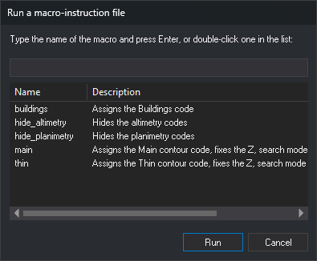

# MACRO_INSTRUCTIONS
<!-- id: macroinstrucciones-2 -->
<!-- origen: c5a05f0d80de67a7de7d047650f99aabf4693d87 -->

Run macroinstructions, also called at-sign macros.

## Parameters

Does not accept parameters.

## Run a macro-instruction file dialog box

Choose the macroinstruction to run in this dialog box.

* **Text box**: enter the macroinstruction name without the at sign and press Enter or click **Run**. As you type, the list shows only macroinstructions whose name or description contains the text, ignoring case.
* **List**: double-click a macroinstruction to run it. Double-clicking an empty part of the list does nothing. Single-clicking a row does not change the text box: **Run** always executes the name entered in that box. The list has **Name** and **Description** columns and shows:
  * macroinstructions from the [code table](../../../editor-de-tablas-de-codigos/pestanas/macroinstrucciones.md), with their descriptions;
  * macroinstruction files (`@nombre`) from the [macro directory](../../../cuadros-de-dialogo/configuracion/diging/directorio-de-macroinstrucciones.md). **Name** shows the file name without the initial at sign. If the first line is a [comment](../../../ordenes/formas-de-ejecutar-una-orden/ejecutar-una-orden-desde-la-linea-de-comandos/macroinstrucciones.md) (starting with `//` or `#`), its text appears as the description.
* **Run**: prefix the entered name with an at sign and execute it as if typed in the [command line](../../../ordenes/formas-de-ejecutar-una-orden/ejecutar-una-orden-desde-la-linea-de-comandos/macroinstrucciones.md). If the box is empty or contains only spaces, sound a warning tone and leave the dialog box open.
* **Cancel**: close without running a macroinstruction.

## Command characteristics

| Command type | [Interactive command](/digi3d-ai/referencia/ordenes/ordenes-interactivas.md) |
| :--- | :--- |
| Repeats automatically | No |
| Menu option | Immediate/Run a macro-instruction file (@)... |
| Toolbar | _This command has no associated toolbar button_ |
| Extension | DigiNG.OrdenesStandard.dll |
| Implementation | Native |
| Related variables | No related variables |
| Related commands | No related commands |
| Internal name | {B1A86A33-6B33-40b2-8C84-693696E7418B} |
