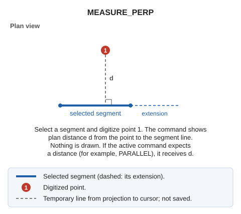

# MEASURE\_PERP
<!-- id: mide-perp -->
<!-- origen: c027e2244d236dff2e78c3a7df0969ab4b77b620 -->

Measure the perpendicular distance from a point to the line through a selected segment.

## Parameters.

Does not accept parameters.

## Notes

Select a segment and digitize a point: the command displays the plan distance from the point to the line through the segment and draws nothing. If the previously active command is waiting for a distance, such as [PARALLEL](/digi3d-ai/referencia/ventana-de-dibujo/ordenes/p/paralela.md), it receives the measured distance.

## Command characteristics

| Command type | [Interactive command](/digi3d-ai/referencia/ordenes/ordenes-interactivas.md) |
| :--- | :--- |
| Repeats automatically | No |
| Menu option | Immediate/Measure a perpendicular distance |
| Toolbar | _This command has no associated toolbar button_ |
| Extension | DigiNG.OrdenesStandard.dll |
| Implementation | Native |
| Related variables | No related variables |
| Related commands | [MEASURE](/digi3d-ai/referencia/ventana-de-dibujo/ordenes/m/mide.md) [MEASURE\_LINE\_PERIMETER](/digi3d-ai/referencia/ventana-de-dibujo/ordenes/m/mide-perimetro-linea.md) [MEASURE\_LINE\_XYZ\_PERIMETER](/digi3d-ai/referencia/ventana-de-dibujo/ordenes/m/mide-perimetro-linea-xyz.md) [MEASURE\_SEGMENT](/digi3d-ai/referencia/ventana-de-dibujo/ordenes/m/mide-segmento.md) [MEASURE\_SEGMENT\_XYZ](/digi3d-ai/referencia/ventana-de-dibujo/ordenes/m/mide-segmento-xyz.md) [MEASURE+](/digi3d-ai/referencia/ventana-de-dibujo/ordenes/m/mide-mas.md) |
| Internal name | {0018D658-03C5-47BE-B795-21D43934C4B9} |
