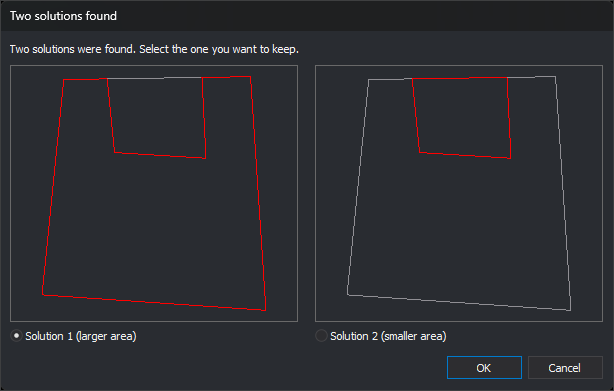

# MOD
<!-- id: mod -->
<!-- origen: e1b194fa6f509d51402dd2006dc030dffab99fda -->

Modify the geometry of an entity in XY.

## Parameters

| Parameter number | Description | Optional |
| :--- | :--- | :--- |
| 1 | Any value. If supplied, the modifying entity is retained after modification, and [LINE](/digi3d-ai/referencia/ventana-de-dibujo/ordenes/l/linea.md) remains active with it | Yes |

## Notes

Draw an entity representing the new path of the entity to modify, then run MOD before finishing the entity being drawn. Draw the new section so it connects to points on the entity to modify.

If no line is being recorded, the command displays "No line is being registered" and ends. The entity to modify must be a line or polygon.

Digi3D.AI projects the first and last vertices of the modifying entity perpendicularly onto the nearest segment of the target entity, then replaces the section between those projections with the modifying vertices. Intersection points are not added as vertices: the new section connects to the original entity vertices. If only one endpoint projects onto the entity, the start or end is replaced.

If both modifying endpoints lie on the target entity, modifying vertex Z coordinates are linearly interpolated between target Z at the start and end points. If only one endpoint projects, Z is unchanged. To avoid modifying elevations, use [MOD\_Z](/digi3d-ai/referencia/ventana-de-dibujo/ordenes/m/mod-z.md).

The modifying entity code is replaced by the target entity code, regardless of the code used while drawing the modifying entity.

### Example

Use this command to correct intersecting contour lines. Draw the section of the contour to modify. You can also correct the contour with EDIT, which modifies individual vertices.

### Modifying a closed entity

If the target entity is closed (or is a polygon boundary or hole) and both modifying endpoints lie on it, the new section divides it into two areas, giving two possible solutions.

The **Two solutions found** dialog asks which solution to keep, displaying "Two solutions were found. Select the one you want to keep."

* Each preview shows the original entity in a muted color, including its holes if it is a polygon, and one solution boundary in red. Both previews use the same scale.
* **Solution 1 (larger area)**: left preview. Selected by default.
* **Solution 2 (smaller area)**: right preview.
* **OK** replaces the entity with the selected solution.
* **Cancel** leaves the entity unchanged and plays the error sound. If MOD ran without a parameter, the modifying entity is discarded and LINE ends. With a parameter, LINE remains active with the modifying entity.

When modifying the boundary of a polygon with holes, a solution is valid only if every hole remains inside the resulting boundary. If only one solution is valid, it is applied without a dialog. If neither is valid, "Unable to perform the modification because the polygon may leave holes outside the exterior outline." appears and the entity remains unchanged.

MOD\_Z, MOD\_MULTIPLE, and MOD\_Z\_MULTIPLE display the same dialog in this situation.

## Command characteristics

| Command type | [Interactive command](/digi3d-ai/referencia/ventana-de-dibujo/ordenes-interactivas.md) |
| :--- | :--- |
| Repeats automatically | No |
| Menu option | Edit/Polylines/Modify an existing polyline on XY with the polyline being registered |
| Toolbar | Modify |
| Extension | DigiNG.OrdenesStandard.dll |
| Implementation | Native |
| Related variables | No related variables |
| Related commands | [MOD\_MULTIPLE](/digi3d-ai/referencia/ventana-de-dibujo/ordenes/m/mod-multiple.md) [MOD\_Z](/digi3d-ai/referencia/ventana-de-dibujo/ordenes/m/mod-z.md) [MOD\_Z\_MULTIPLE](/digi3d-ai/referencia/ventana-de-dibujo/ordenes/m/mod-z-multiple.md) |
| Internal name | {0A6E6F7E-3A79-4726-BFAA-50A552634A5B} |
