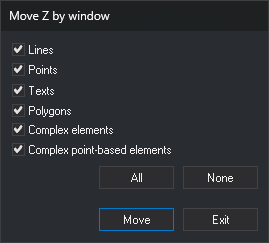

# MOVE\_Z\_W
<!-- id: mover-z-v -->
<!-- origen: c4e4bc4ae0274a00e08c6d65bb61c75ba3a40f0a -->

Change the elevation of entities inside a closed entity.

## Parameters

| Parameter number | Description | Optional |
| :--- | :--- | :--- |
| 1 | [Geometry types](/digi3d-ai/referencia/ventana-de-dibujo/tipos-de-geometria.md) whose elevation to change, as a string of letters. For example, `PT`. `B` has no effect in this command | Yes. If omitted, display a dialog box for choosing types when selecting the boundary |

## Notes

Before running, draw a closed line to use as the boundary.

1. Select the boundary line.
2. Digitize the origin point.
3. Digitize the destination point.

Add the Z difference between destination and origin to visible entities of the chosen types inside the boundary, and show how many were modified. Entities crossing the boundary are unchanged.

Handle each entity independently: if Digi3D.AI rejects a moved entity, retain its original; entities whose moves are accepted are moved.

## Command characteristics

| Command type | [Interactive command](/digi3d-ai/referencia/ordenes/ordenes-interactivas.md) |
| :--- | :--- |
| Repeats automatically | No |
| Menu option | DTM/Move points on Z based on window |
| Toolbar | _This command has no associated toolbar button_ |
| Extension | DigiNG.OrdenesMDT.dll |
| Implementation | Native |
| Related variables | No related variables |
| Related commands | [MOVE\_Z](/digi3d-ai/referencia/ventana-de-dibujo/ordenes/m/mover-z.md) |
| Internal name | {B2D8B252-EC8E-4580-B938-24A3AED647D4} |
