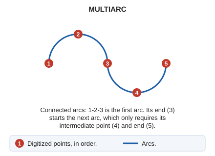

# MULTIARC
<!-- id: multiarco -->
<!-- origen: 5e1db831eda8bf4088098a823404b217eaf67947 -->

Draw consecutive, connected arcs.

## Parameters

Does not accept parameters.

## Notes

For two consecutive arcs, the last point of the first arc coincides with the first point of the second.

## Command characteristics

| Command type | [Interactive command](/digi3d-ai/referencia/ordenes/ordenes-interactivas.md) |
| :--- | :--- |
| Repeats automatically | No |
| Menu option | Draw/Arc sequence |
| Toolbar | Polylines |
| Extension | DigiNG.OrdenesStandard.dll |
| Implementation | Native |
| Related variables | [BEEPS](/digi3d-ai/referencia/ventana-de-dibujo/variables/p/pita.md) — enable or disable sounds [REPEAT](/digi3d-ai/referencia/ventana-de-dibujo/variables/r/repite.md) — repeat the last command executed |
| Related commands | [ARC](/digi3d-ai/referencia/ventana-de-dibujo/ordenes/a/arco.md) [TANGENT\_ARC](/digi3d-ai/referencia/ventana-de-dibujo/ordenes/a/arco-tangente.md) |
| Internal name | {439FBB9E-ED74-4134-8B62-7C5650A55784} |
