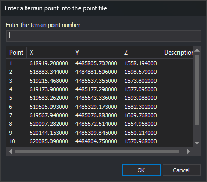

# N
<!-- id: n-2 -->
<!-- origen: 9cd027b003ad001ec3a4a43124917ab83b1b0064 -->

Pass the coordinates of a point from the point file to the active command. Select the point by name in a dialog box.

## Parameters

Does not accept parameters.

## Notes

### Point file

The command reads the point file assigned with [P\_FILE](/digi3d-ai/referencia/ventana-de-dibujo/ordenes/f/fichero-p.md). [ADD](/digi3d-ai/referencia/ventana-de-dibujo/ordenes/a/agrega.md) and [GO\_TO\_CONTROL\_POINT](/digi3d-ai/referencia/ventana-fotogrametrica/ordenes/i/ir-a-punto-apoyo.md) use the same file. If no file is assigned or the assigned file does not exist, the command displays a dialog box for selecting one and keeps it assigned for subsequent executions. If you cancel that dialog box, the command finishes.

The command reads the file once, at startup. Points you add later with ADD appear in the list the next time you run N.

Each file line contains the data for one point, separated by commas, whitespace, tabs, or `=`. The command ignores lines with fewer than four data items:

| Data item | Description | Values | Optional |
| :--- | :--- | :--- | :--- |
| First | Point name. Enclose names containing spaces, commas, or `=` in double quotation marks. ADD writes the quotation marks | Text | No |
| Second | X coordinate | Real number | No |
| Third | Y coordinate | Real number | No |
| Fourth | Z coordinate | Real number | No |
| Fifth | Point description: the rest of the line, including spaces. If the description is enclosed in quotation marks, the command removes them. If ADD saved the point by selecting an entity with a code, that code precedes the description | Text | Yes |

### Dialog box

The _Enter a terrain point into the point file_ dialog box displays the file's points in a list with _Point_, _X_, _Y_, _Z_, and _Description_ columns. Type the point name in _Enter the terrain point number_, or click a list row, then click _OK_.

The command searches for the point in this order:

1. If you clicked a row and did not change _Enter the terrain point number_, it searches for the point in that row.
2. A point whose name exactly matches the field text. Matching is case-sensitive.
3. If the text is a single word in quotation marks, a point with that name without the quotation marks.
4. If the text is an integer, the first point whose name is that number: `5` finds point `005`.

If it finds the point, the command moves the cursor to its coordinates and passes them as a point to the active command. The active command receives only the coordinates, without the point name or description.

If no command is active, N runs the command corresponding to the active code before sending the point:

- The commands associated with the code in the code table, if any.
- [HEIGHT](/digi3d-ai/referencia/ventana-de-dibujo/ordenes/c/cota.md), if the active code matches the first code in [COD\_HEIGHTS](/digi3d-ai/referencia/ventana-de-dibujo/ordenes/c/cod-cotas.md).
- [LINE](/digi3d-ai/referencia/ventana-de-dibujo/ordenes/l/linea.md), if the code is linear or virtual.
- [POINT](/digi3d-ai/referencia/ventana-de-dibujo/ordenes/p/punto.md), otherwise.

### Point ranges

If you enter two integers separated by a space or comma, such as `10 20`, and no point has that name, the command passes the points whose names are numbers in the range to the active command, one after another. It sends them in ascending order if the first number is less than the second, and descending order otherwise. Range numbers absent from the file are skipped. The cursor does not move when using a range.

### Messages

If the point is not found, the command displays _Error: The point “name” could not be located in file “file”_. For a range, if either endpoint is missing, it displays _Error: The point “start” or point “end” on file “file” could not be located_ and sends no points.

While the dialog box is displayed, the command line shows _Digitizes point_.

Click _Cancel_, or _OK_ with an empty field, to finish the command.

If [REPEAT](/digi3d-ai/referencia/ventana-de-dibujo/variables/r/repite.md) is enabled, the dialog box reappears after each point, including after an error message. Otherwise, the command finishes.

## Command characteristics

| Command type | [Interactive command](/digi3d-ai/referencia/ordenes/ordenes-interactivas.md) |
| :--- | :--- |
| Repeats automatically | Yes |
| Menu option | _This command has no associated menu option_ |
| Toolbar | _This command has no associated toolbar button_ |
| Extension | DigiNG.OrdenesStandard.dll |
| Implementation | Native |
| Related variables | [REPEAT](/digi3d-ai/referencia/ventana-de-dibujo/variables/r/repite.md) — repeat the last command executed |
| Related commands | [ADD](/digi3d-ai/referencia/ventana-de-dibujo/ordenes/a/agrega.md) [COD\_HEIGHTS](/digi3d-ai/referencia/ventana-de-dibujo/ordenes/c/cod-cotas.md) [P\_FILE](/digi3d-ai/referencia/ventana-de-dibujo/ordenes/f/fichero-p.md) [GO\_TO\_CONTROL\_POINT](/digi3d-ai/referencia/ventana-fotogrametrica/ordenes/i/ir-a-punto-apoyo.md) |
| Internal name | {B4C60C59-89B2-4402-8C5F-307DD0C8EE86} |
