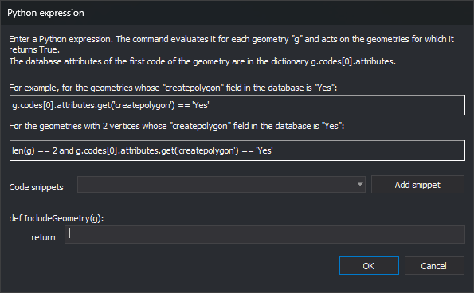

# ON\_PYTHON\_EXPRESSION
<!-- id: on-expresion-python -->
<!-- origen: 6b1dd4ddc98099bf49f2a1f2498870470b359ba1 -->

Show entities for which a Python expression returns true. The command evaluates the expression for each entity in all loaded drawing files and clears the hidden flag for those that match.

## Parameters

| Parameter number | Description | Optional |
| :--- | :--- | :--- |
| 1 | Python expression. All text after the `=` sign forms the expression. Leading and trailing spaces are ignored.<br>or<br>Names of code table [selections](/digi3d-ai/referencia/editor-de-tablas-de-codigos/pestanas/selecciones.md), each preceded by `#` and separated by spaces. | Yes. Without parameters, the command displays the **Python expression** dialog box. |

The command uses selection names only if the first parameter starts with `#`. In that case, it ignores parameters that do not start with `#`. Names are case-insensitive. A name that does not exist in the code table is silently ignored. Enclose names containing spaces in quotation marks: `ON_PYTHON_EXPRESSION="#Zonas verdes"`.

## The expression

* This is a single Python 3 expression, not a script: `import`, assignments, and blocks are not allowed. Python 3 does not support the `<>` operator: use `!=`.
* The variable `g` contains the geometry being evaluated. It is a [Geometry](/digi3d-ai/programacion/python/referencia/digi21.base/geometry.md) object whose concrete type is `Point`, `Text`, `Line`, `Polygon`, or `Complex`.
* No variable is created for each attribute. The first code's database attributes are in the `g.codes[0].attributes` dictionary (field name → value). If the attributes have not yet been read, reading `attributes` queries the database.
* The expression must return `True` or `False`. `None` (false) or a number (true if nonzero) is also accepted. A string, list, or other type produces an error.
* The expression can use Python built-in functions (such as `len` or `type`) and names defined by the code table's [Python environment](/digi3d-ai/referencia/editor-de-tablas-de-codigos/pestanas/entorno-python.md), including its functions. Digi3D.AI executes the environment in the Python interpreter's `__main__` module when opening the drawing file. When the command is run from the command line, a menu, or a macro, it evaluates the expression in that same module.
* If evaluating the expression accesses a name not defined in the `__main__` module (the variable `g` and environment names) or among Python's built-in names, Python raises a `NameError`. For example, the environment downloaded from GitHub contains `import digi3d`, so the expression can use `digi3d.Text`; to write `Text` without the `digi3d.` prefix, the environment must import that name with a line such as `from digi3d import Text`.

## Dialog box



The dialog box is the same for [OFF\_PYTHON\_EXPRESSION](/digi3d-ai/referencia/ventana-de-dibujo/ordenes/o/off_expresion_python.md), [ON\_ONLY\_PYTHON\_EXPRESSION](/digi3d-ai/referencia/ventana-de-dibujo/ordenes/o/on_solo_expresion_python.md), and [SELECT\_PYTHON\_EXPRESSION](/digi3d-ai/referencia/ventana-de-dibujo/ordenes/s/selecciona_expresion_python.md). Enter the expression in the field after `return`. The dialog box does not remember the previous expression.

To insert a snippet, choose it from the **Code snippets** drop-down list and click **Add snippet**. The snippet is appended to the expression. The snippets are:

| Snippet | Meaning |
| :--- | :--- |
| `==`, `!=`, `<`, `>`, `<=`, `>=`, `and`, `and not`, `not`, `True`, `False` | Python operators and values |
| `type(g).__name__ == 'Point'` (also `'Line'`, `'Text'`, `'Polygon'`, and `'Complex'`) | Geometry type. A polygon is not `'Line'`. |
| `g.has_code('code')` | The geometry has the specified code. Supports `*` and `?` wildcards. |
| `len(g)` | Number of vertices |
| `g[0]` | First vertex coordinates `(x, y, z)` |
| `g.codes[0].attributes.get('field')` | Value of the first code's `field` field, or `None` if it does not exist |
| `g.area`, `g.perimeter_2d`, `g.closed` | Area, plan perimeter, and whether it is closed. Only for lines and polygons; `closed` also applies to complex geometries. |
| `g.text` | Text string. Only for text geometries. |

Replace `code` and `field` with the actual code and field.

## Errors

If the expression has a syntax error or raises an exception for any geometry, Digi3D.AI displays a message box starting with the Python error type and text, such as `NameError: name 'Text' is not defined`. For example, `g.area` for a point and `attributes['campo']` for a nonexistent field raise exceptions.

After an error, the command stops evaluating the expression in the drawing file where it occurred and does not show any entities from that file based on that expression, even if the expression returned true for other geometries in the same file before the error. With multiple selection names (`#`), the command shows entities matching selections whose expressions do not fail. If other drawing files remain loaded, the command evaluates the expression in the next file, so the message box appears once for each drawing file where the expression fails. With selection names (`#`), it appears once for each selection and drawing file where the expression fails.

If the command is part of a [macro](/digi3d-ai/referencia/ordenes/formas-de-ejecutar-una-orden/ejecutar-una-orden-desde-la-linea-de-comandos/macroinstrucciones.md) (`@`), Digi3D.AI runs the next command in the macro after the user closes the message box.

The [Update a code table's Python quality controls](/digi3d-ai/usuarios-de-versiones-anteriores/actualizar-guiones-python.md#errors-after-replacing-the-environment) page explains `NameError` and `AttributeError` errors in expressions written for earlier versions of Digi3D.

To avoid errors:

* Check the type first. `and` only evaluates the second condition if the first is true: `type(g).__name__ == 'Line' and g.area > 100`.
* Read fields with `.get('campo')`, which returns `None` if the field does not exist.

### Examples

To show entities with exactly 3 vertices:

```text
ON_PYTHON_EXPRESSION=len(g) == 3
```

To show entities whose first code is '010101', with 7 vertices, and whose Propietario database field equals 'Dylan':

```text
ON_PYTHON_EXPRESSION=g.codes[0].code == '010101' and len(g) == 7 and g.codes[0].attributes.get('Propietario') == 'Dylan'
```

To show entities matching the code table's "Edificios" selection:

```text
ON_PYTHON_EXPRESSION=#Edificios
```

To show entities matching the "Edificios" or "Deportivo" selection:

```text
ON_PYTHON_EXPRESSION=#Edificios #Deportivo
```

## Notes

* The command acts on all entities in all loaded drawing files, including deleted entities.
* Showing or hiding by expression is a flag on each entity. It is independent of visibility by code: an entity whose code is disabled is still not drawn.
* Hidden entities are not drawn in the drawing or photogrammetric window. [SEE\_ALL\_ENTITIES](/digi3d-ai/referencia/ventana-de-dibujo/ordenes/v/ver-todas-entidades.md) clears the hidden flag for all entities.

## Command characteristics

| Command type | Immediate command |
| :--- | :--- |
| Repeats automatically | No |
| Menu option | View/Those that comply with Python expression... |
| Toolbar | _This command has no associated toolbar button_ |
| Extension | DigiNG.OrdenesStandard.dll |
| Implementation | Native |
| Related variables | No related variables |
| Related commands | [OFF\_PYTHON\_EXPRESSION](/digi3d-ai/referencia/ventana-de-dibujo/ordenes/o/off_expresion_python.md)<br>[OFF\_ALL](/digi3d-ai/referencia/ventana-de-dibujo/ordenes/o/off_todo.md)<br>[ON\_ONLY\_PYTHON\_EXPRESSION](/digi3d-ai/referencia/ventana-de-dibujo/ordenes/o/on_solo_expresion_python.md)<br>[SELECT\_PYTHON\_EXPRESSION](/digi3d-ai/referencia/ventana-de-dibujo/ordenes/s/selecciona_expresion_python.md)<br>[SEE\_ALL\_ENTITIES](/digi3d-ai/referencia/ventana-de-dibujo/ordenes/v/ver-todas-entidades.md) |
| Internal name | {CC07AD2F-1CB4-485E-B8D0-A8B1F449DCB0} |
