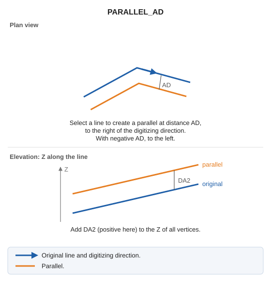

# PARALLEL\_AD
<!-- id: paralela-da -->
<!-- origen: 9c428b573ce2f936d98497fb299090da480f589b -->

Draw a parallel with parameters from the Active distance variable.

## Parameters

Does not accept parameters.

## Notes

Select a line to generate its parallel at [active distance AD](/digi3d-ai/referencia/ventana-de-dibujo/variables/d/da.md), to the right of its digitizing direction. A negative AD generates the parallel to the left. Add distance DA2 to every parallel vertex's Z.

## Command characteristics

| Command type | [Interactive command](/digi3d-ai/referencia/ordenes/ordenes-interactivas.md) |
| :--- | :--- |
| Repeats automatically | Yes |
| Menu option | _This command has no associated menu option_ |
| Toolbar | _This command has no associated toolbar button_ |
| Extension | DigiNG.OrdenesStandard.dll |
| Implementation | Native |
| Related variables | [AD](/digi3d-ai/referencia/ventana-de-dibujo/variables/d/da.md) — active distance [REPEAT](/digi3d-ai/referencia/ventana-de-dibujo/variables/r/repite.md) — repeat the last command executed |
| Related commands | [PARALLEL](/digi3d-ai/referencia/ventana-de-dibujo/ordenes/p/paralela.md) [PARALLEL\_Z](/digi3d-ai/referencia/ventana-de-dibujo/ordenes/p/paralela-z.md) |
| Internal name | {6C27BAFC-420A-4CFE-8F83-A36CBEFC56C0} |
