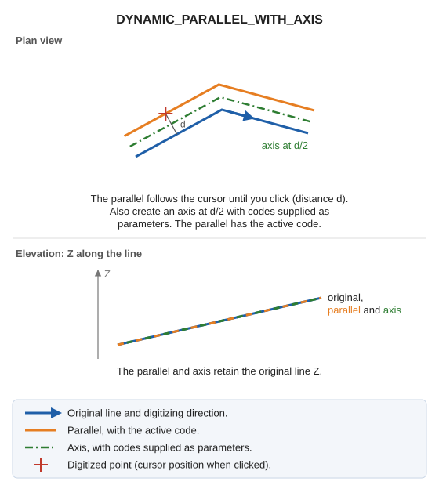

# DYNAMIC\_PARALLEL\_WITH\_AXIS
<!-- id: paralela-dinamica-con-eje -->
<!-- origen: f268acbf6838f7a9dce7a72fe453c5989392695f -->

Draw a dynamic parallel with active codes and, between the original line and the parallel, an axis with codes specified as parameters.

## Parameters

| Parameter number | Description | Optional |
| :--- | :--- | :--- |
| 1 and subsequent | Axis codes. | Yes |

## Notes

Select the line and click to fix the parallel's position; until you click, its position follows the cursor. Also draw an axis halfway between the original line and the parallel, with codes supplied as parameters. The parallel uses the active code.
The parallel and axis retain the original line's Z.

## Command characteristics

| Command type | [Interactive command](/digi3d-ai/referencia/ordenes/ordenes-interactivas.md) |
| :--- | :--- |
| Repeats automatically | Yes |
| Menu option | Draw/More/Dynamic parallel with axis in XY |
| Toolbar | Parallels |
| Extension | DigiNG.OrdenesStandard.dll |
| Implementation | Native |
| Related variables | [REPEAT](/digi3d-ai/referencia/ventana-de-dibujo/variables/r/repite.md) — repeat the last command executed |
| Related commands | [DYNAMIC\_PARALLEL](/digi3d-ai/referencia/ventana-de-dibujo/ordenes/p/paralela-dinamica.md) [DYNAMIC\_PARALLEL\_WITH\_AXIS\_Z](/digi3d-ai/referencia/ventana-de-dibujo/ordenes/p/paralela-dinamica-con-eje-z.md) [DYNAMIC\_PARALLEL\_WITH\_AXIS\_ACTIVE\_Z](/digi3d-ai/referencia/ventana-de-dibujo/ordenes/p/paralela-dinamica-con-eje-z-activa.md) |
| Internal name | {8455DA79-71E9-4A5D-B5DB-2CF259F31F87} |
