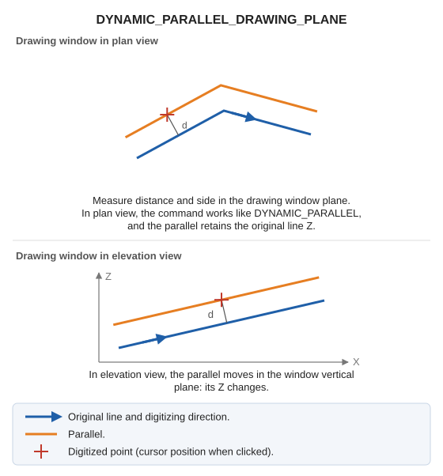

# DYNAMIC\_PARALLEL\_DRAWING\_PLANE
<!-- id: paralela-dinamica-plano-dibujo -->
<!-- origen: 54d2d586fc16dc134cf22cd32fdb01e3a1669671 -->

Draw a dynamic parallel in the drawing window plane.

## Parameters

Does not accept parameters.

## Command characteristics

| Command type | [Interactive command](/digi3d-ai/referencia/ordenes/ordenes-interactivas.md) |
| :--- | :--- |
| Repeats automatically | Yes |
| Menu option | _This command has no associated menu option_ |
| Toolbar | _This command has no associated toolbar button_ |
| Extension | DigiNG.OrdenesStandard.dll |
| Implementation | Native |
| Related variables | [REPEAT](/digi3d-ai/referencia/ventana-de-dibujo/variables/r/repite.md) — repeat the last command executed |
| Related commands | [DYNAMIC\_PARALLEL](/digi3d-ai/referencia/ventana-de-dibujo/ordenes/p/paralela-dinamica.md) [DYNAMIC\_PARALLEL\_XYZ](/digi3d-ai/referencia/ventana-de-dibujo/ordenes/p/paralela-dinamica-xyz.md) [DYNAMIC\_PARALLEL\_FIXED\_Z](/digi3d-ai/referencia/ventana-de-dibujo/ordenes/p/paralela-dinamica-z-fija.md) |
| Internal name | {278C9520-3941-49B6-B983-1544BF7AC151} |
