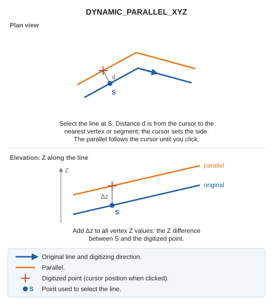

# DYNAMIC\_PARALLEL\_XYZ
<!-- id: paralela-dinamica-xyz -->
<!-- origen: 76dd84051c60bcf4d38da84afa18dac2342c413f -->

Draw a line parallel to an entity at a specified distance, accounting for Z in the photogrammetric window.

## Parameters

Does not accept parameters: select the distance by clicking in the drawing window.

## Notes

Generate parallels with the code active when the command starts.

Add the Z difference between the point used to select the line and the digitized point to every parallel vertex's Z.

## Command characteristics

| Command type | [Interactive command](/digi3d-ai/referencia/ordenes/ordenes-interactivas.md) |
| :--- | :--- |
| Repeats automatically | Yes |
| Menu option | Draw/More/Dynamic parallel in XYZ |
| Toolbar | Parallels |
| Extension | DigiNG.OrdenesStandard.dll |
| Implementation | Native |
| Related variables | [REPEAT](/digi3d-ai/referencia/ventana-de-dibujo/variables/r/repite.md) — repeat the last command executed |
| Related commands | [DYNAMIC\_PARALLEL](/digi3d-ai/referencia/ventana-de-dibujo/ordenes/p/paralela-dinamica.md) [DYNAMIC\_PARALLEL\_WITH\_AXIS\_Z](/digi3d-ai/referencia/ventana-de-dibujo/ordenes/p/paralela-dinamica-con-eje-z.md) [DYNAMIC\_PARALLEL\_DRAWING\_PLANE](/digi3d-ai/referencia/ventana-de-dibujo/ordenes/p/paralela-dinamica-plano-dibujo.md) [DYNAMIC\_PARALLEL\_FIXED\_Z](/digi3d-ai/referencia/ventana-de-dibujo/ordenes/p/paralela-dinamica-z-fija.md) |
| Internal name | {4B0A66A9-EE66-4BBC-9484-04B371BD49EB} |
