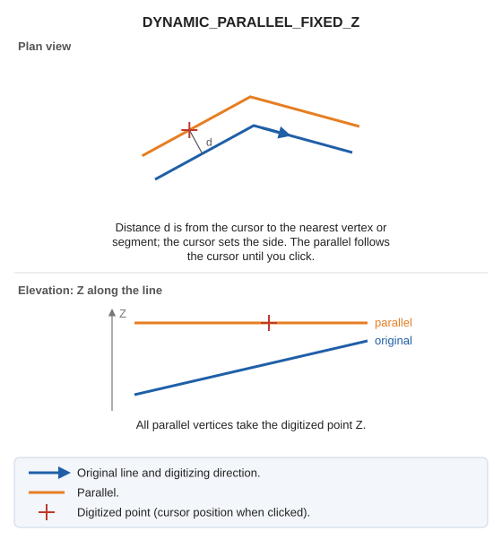

# DYNAMIC\_PARALLEL\_FIXED\_Z
<!-- id: paralela-dinamica-z-fija -->
<!-- origen: 484c29fb6f0d9e70a62627a73e07401fece8a0c1 -->

Draw a line parallel to an entity at a specified distance, with the digitized point's Z.

## Parameters

Does not accept parameters: select the distance by clicking in the drawing window.

## Notes

Generate parallels with the code active when the command starts.

All parallel vertices take the digitized point's Z.

## Command characteristics

| Command type | [Interactive command](/digi3d-ai/referencia/ordenes/ordenes-interactivas.md) |
| :--- | :--- |
| Repeats automatically | Yes |
| Menu option | Draw/More/Dynamic parallel with active Z |
| Toolbar | Parallels |
| Extension | DigiNG.OrdenesStandard.dll |
| Implementation | Native |
| Related variables | [REPEAT](/digi3d-ai/referencia/ventana-de-dibujo/variables/r/repite.md) — repeat the last command executed |
| Related commands | [DYNAMIC\_PARALLEL](/digi3d-ai/referencia/ventana-de-dibujo/ordenes/p/paralela-dinamica.md) [DYNAMIC\_PARALLEL\_WITH\_AXIS\_ACTIVE\_Z](/digi3d-ai/referencia/ventana-de-dibujo/ordenes/p/paralela-dinamica-con-eje-z-activa.md) [DYNAMIC\_PARALLEL\_DRAWING\_PLANE](/digi3d-ai/referencia/ventana-de-dibujo/ordenes/p/paralela-dinamica-plano-dibujo.md) [DYNAMIC\_PARALLEL\_XYZ](/digi3d-ai/referencia/ventana-de-dibujo/ordenes/p/paralela-dinamica-xyz.md) |
| Internal name | {44396872-F1D4-4C30-A8E2-17693C160788} |
