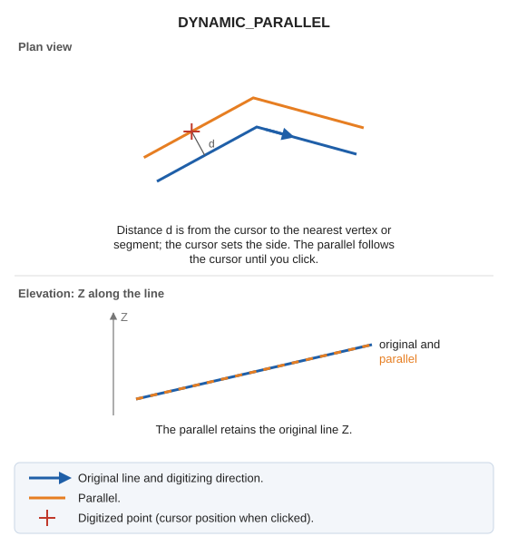

# DYNAMIC\_PARALLEL
<!-- id: paralela-dinamica -->
<!-- origen: d484815adf16524c2fd27b23c379b8cb4e31bc69 -->

Draw a line parallel to an entity at a specified distance. Preview its position as you move the cursor.

## Parameters

Does not accept parameters: select the distance by clicking in the drawing window.

## Notes

Generate parallels with the code active when the command starts.

The distance is from the cursor to the nearest vertex or segment of the original line. The parallel retains the original line's Z.

## Command characteristics

| Command type | [Interactive command](/digi3d-ai/referencia/ordenes/ordenes-interactivas.md) |
| :--- | :--- |
| Repeats automatically | Yes |
| Menu option | Draw/More/Dynamic parallel in XY |
| Toolbar | Parallels |
| Extension | DigiNG.OrdenesStandard.dll |
| Implementation | Native |
| Related variables | [REPEAT](/digi3d-ai/referencia/ventana-de-dibujo/variables/r/repite.md) — repeat the last command executed |
| Related commands | [PARALLEL](/digi3d-ai/referencia/ventana-de-dibujo/ordenes/p/paralela.md) [DYNAMIC\_PARALLEL\_WITH\_AXIS](/digi3d-ai/referencia/ventana-de-dibujo/ordenes/p/paralela-dinamica-con-eje.md) [DYNAMIC\_PARALLEL\_DRAWING\_PLANE](/digi3d-ai/referencia/ventana-de-dibujo/ordenes/p/paralela-dinamica-plano-dibujo.md) [DYNAMIC\_PARALLEL\_XYZ](/digi3d-ai/referencia/ventana-de-dibujo/ordenes/p/paralela-dinamica-xyz.md) [DYNAMIC\_PARALLEL\_FIXED\_Z](/digi3d-ai/referencia/ventana-de-dibujo/ordenes/p/paralela-dinamica-z-fija.md) |
| Internal name | {78C231A3-A299-4368-8B5F-C72A3FB9109B} |
