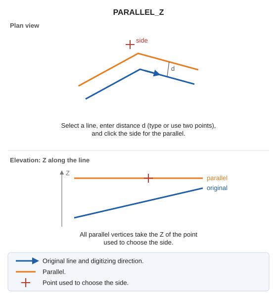

# PARALLEL\_Z
<!-- id: paralela-z -->
<!-- origen: 3f0acea59be785ef1359b57c3ca46bef662cbf75 -->

Draw a parallel to an existing line, assigning the digitized point's Z to every generated vertex.

## Parameters

Does not accept parameters.

## Notes

Select a line, specify the distance, and click the side where the parallel should be generated, as with [PARALLEL](/digi3d-ai/referencia/ventana-de-dibujo/ordenes/p/paralela.md). The difference is that all parallel vertices take the Z of the point used to choose the side.

## Command characteristics

| Command type | [Interactive command](/digi3d-ai/referencia/ordenes/ordenes-interactivas.md) |
| :--- | :--- |
| Repeats automatically | No |
| Menu option | Draw/More/Classic parallel (selection/distance/side) with active Z |
| Toolbar | _This command has no associated toolbar button_ |
| Extension | DigiNG.OrdenesStandard.dll |
| Implementation | Native |
| Related variables | [AD](/digi3d-ai/referencia/ventana-de-dibujo/variables/d/da.md) — active distance [REPEAT](/digi3d-ai/referencia/ventana-de-dibujo/variables/r/repite.md) — repeat the last command executed |
| Related commands | [PARALLEL](/digi3d-ai/referencia/ventana-de-dibujo/ordenes/p/paralela.md) [PARALLEL\_AD](/digi3d-ai/referencia/ventana-de-dibujo/ordenes/p/paralela-da.md) |
| Internal name | {351A5010-8CDA-4DDA-AB3A-A0DA6E9631EE} |
