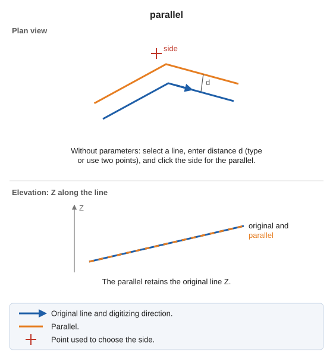

# PARALLEL
<!-- id: paralela -->
<!-- origen: 37418d51b78096e99a9a6e94db1772a3e6c657bb -->

Draw lines parallel to one or more entities at a specified distance.

## Parameters

| Parameter number | Description | Optional |
| :--- | :--- | :--- |
| 1 | Code. If supplied, without further prompts generate a parallel to each visible line with that code at [active distance AD](/digi3d-ai/referencia/ventana-de-dibujo/variables/d/da.md), to the right of each line's digitizing direction, and add DA2 to each parallel's Z. | Yes |

## Notes

Without parameters:

1. Select the line.
2. Specify the distance: enter it in the status bar and press Enter, or digitize two points (the distance is their plan separation).
3. Click the side of the line where the parallel should be generated.

The parallel retains the original line's Z. Parallels are generated with the code active when the command starts.

## Command characteristics

| Command type | [Interactive command](/digi3d-ai/referencia/ordenes/ordenes-interactivas.md) |
| :--- | :--- |
| Repeats automatically | Yes |
| Menu option | Draw/More/Classic parallel (selection/distance/side) |
| Toolbar | _This command has no associated toolbar button_ |
| Extension | DigiNG.OrdenesStandard.dll |
| Implementation | Native |
| Related variables | [REPEAT](/digi3d-ai/referencia/ventana-de-dibujo/variables/r/repite.md) |
| Related commands | [PARALLEL\_AD](/digi3d-ai/referencia/ventana-de-dibujo/ordenes/p/paralela-da.md) [DYNAMIC\_PARALLEL](/digi3d-ai/referencia/ventana-de-dibujo/ordenes/p/paralela-dinamica.md) [PARALLEL\_Z](/digi3d-ai/referencia/ventana-de-dibujo/ordenes/p/paralela-z.md) |
| Internal name | {C98B960F-F4D1-4f65-8945-029EB0914CA7} |
