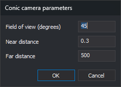

# PERSPECTIVE\_CAMERA\_PARAMETERS
<!-- id: parametros-camara-conica -->
<!-- origen: 2f4e88fad765dc0ab2239ae518c9add5d2222e77 -->

Set the field of view and clipping plane distances of the drawing window perspective camera.

## Parameters

| Parameter number | Description | Optional |
| :--- | :--- | :--- |
| 1 | Vertical field of view in degrees. Must be greater than 0 and less than 180. Default: 45 | Yes |
| 2 | Near clipping plane distance, in drawing coordinate units. Must be greater than 0 and less than the far distance. Default: 0.3 | Yes |
| 3 | Far clipping plane distance, in drawing coordinate units. Must be greater than the near distance. Default: 500 | Yes |

Use a decimal point in parameters.

## Notes

The perspective camera draws only entities between the near and far clipping planes. Plane distances are measured from the camera position along its viewing direction.

If you specify all three parameters, the command does not display the dialog box: it validates and saves the values, then finishes. If a parameter is not a number or the values do not meet the conditions in the parameter table, the command displays an error message and saves nothing. Parameters after the third are ignored.

If you specify one or two parameters, or none, the command displays the dialog box. Its fields show the supplied parameters and the last saved values for any omitted parameters.

The command saves all three values in `Fov`, `NearDist`, and `FarDist` under the registry key `HKEY_CURRENT_USER\Software\Digi21\Digi3D.NET\DigiNG\Configuration`. Saved values persist across sessions.

If the drawing window uses a perspective camera, the command applies the values to the camera and refreshes the view. With an orthographic camera, it only saves the values; [PERSPECTIVE\_CAMERA](/digi3d-ai/referencia/ventana-de-dibujo/ordenes/c/camara-conica.md) applies them when enabling the perspective camera.

### Dialog box

The _Conic camera parameters_ dialog box has three fields:

- _Field of view (degrees)_: vertical camera field of view, in degrees.
- _Near distance_: near clipping plane distance.
- _Far distance_: far clipping plane distance.

Click _OK_ to validate the values. If a field is not a number or the values do not meet the conditions in the parameter table, the dialog box displays a message, moves the cursor to the field to correct, and remains open without saving anything. If the values are valid, the command saves them in the registry and applies them to the camera.

Click _Cancel_ to finish without saving the values or changing the camera.

## Command characteristics

| Command type | Immediate command |
| :--- | :--- |
| Repeats automatically | No |
| Menu option | _This command has no associated menu option_ |
| Toolbar | _This command has no associated toolbar button_ |
| Extension | DigiNG.OrdenesStandard.dll |
| Implementation | Native |
| Related variables | No related variables |
| Related commands | [PERSPECTIVE\_CAMERA](/digi3d-ai/referencia/ventana-de-dibujo/ordenes/c/camara-conica.md) [ORTHOGRAPHIC\_CAMERA](/digi3d-ai/referencia/ventana-de-dibujo/ordenes/c/camara-ortofonal.md) |
| Internal name | {4E593400-6A19-45CE-9A70-75D311A0C09D} |
